# Soft biome lighting and detail

Light pools now use continuous radial alpha falloff rather than coarse quantized blocks. A separate ambient mask lifts the original surface colours near visible emitters; a restrained colour wash gives lamps/forges warm pools and crystals/mushrooms cooler glows. Small halos align with the lamp head or emissive part of a prop instead of only brightening its floor tile.

The other source of square brightness was the per-tile jump between visible and remembered terrain. The renderer now composites a softened visibility alpha mask. Only the light/memory masks are smoothed; artwork, actor sprites, weapons and terrain stay on their native pixel grid. Enemy visibility, exploration, AI lighting, line-of-sight, `L.light`, `vis`, turn timing and detection rules are unchanged.

## Biome character

- Mines: amber lamps against cool rock, mineral chips and compacted earth.
- Crypts/abbey: wax-coloured pools, cooler shadow tint, worn slabs and moss/dust along wall margins.
- Fungal hollows: overlapping cool green mushroom light, root/hypha mats, shelf growth and gently pulsing emitters. The former rectangular fungal glow is removed.
- Drowned vaults/sewers: blue-green shadows, wet stone and silt transitions near actual water, barnacles and subdued shoreline marks.
- Town: warm lamp pools, lamp-head halos and forge tones; existing paths and service access remain intact.

## Visibility, shadows and performance

Visible source pools are clipped by ray-cast wall/closed-door/gate/opaque-prop/grass geometry. Opening a door or changing opacity invalidates the shadow cache. Hidden sources do not generate pools, and colour wash is clipped to explored geometry. A small amount of face illumination is allowed at the wall hit, not through the wall.

Rendering is bounded to 32 nearby on-screen sources, 64 radial textures and 80 shadow paths per level. Radial textures are cached; the ambient viewport surface is reused. The small visibility-mask canvas is rebuilt only when the visibility/exploration signature changes. Reduced motion freezes flicker and glow and disables motes. There is no gameplay RNG consumption and no new collision or interactable object.

The floor/wall drawing hooks defer memory dimming to the new mask while the lighting module is available. The previous renderer remains the fallback if the module cannot load. Ground detail stays below decals/telegraphs/actors; surface replacement never replaces special terrain such as water, pits, webs or cracked walls.

## Validation

- `npm test`: **80 passing**, including continuous falloff, wall/door rays, physical and visible sources, state/RNG immutability, reduced motion and biome material checks.
- `npm run test:lighting`: five real desktop scenes; before/after comparisons; actual canvas alpha has more than 40 falloff levels; wall occlusion, open-door invalidation, opaque-prop invalidation and softened memory edges pass. Reduced-motion output is identical across different timestamps. Canvas smoothing is restored to disabled after mask compositing.
- Rendering comparisons preserve simulation lighting, FOV, turn, health and equipment data. Normal-visibility views are also captured.
- Desktop tactics, weapons and flat-reference browser regressions pass locally. The environment workflow runs the new lighting suite and uploads screenshots.
- Local 1440×1000 Chromium full-scene draws average roughly **8–14 ms** over 30 warm renders per scene. This is not a universal frame-rate promise; Safari and physical GPU performance have not been measured.

## Lighting-only comparisons

Same map, native surfaces, camera, actors and frozen time in each pair. Before substitutes the former light pass; after uses the new light pass. Visibility is revealed in these comparisons to make the light placement easy to inspect.

| Biome | Before | After |
|---|---|---|
| Town | 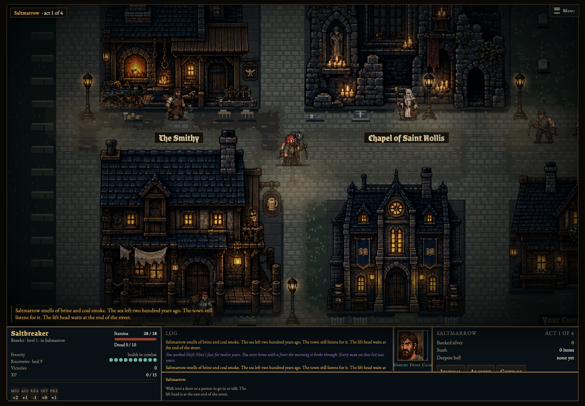 | 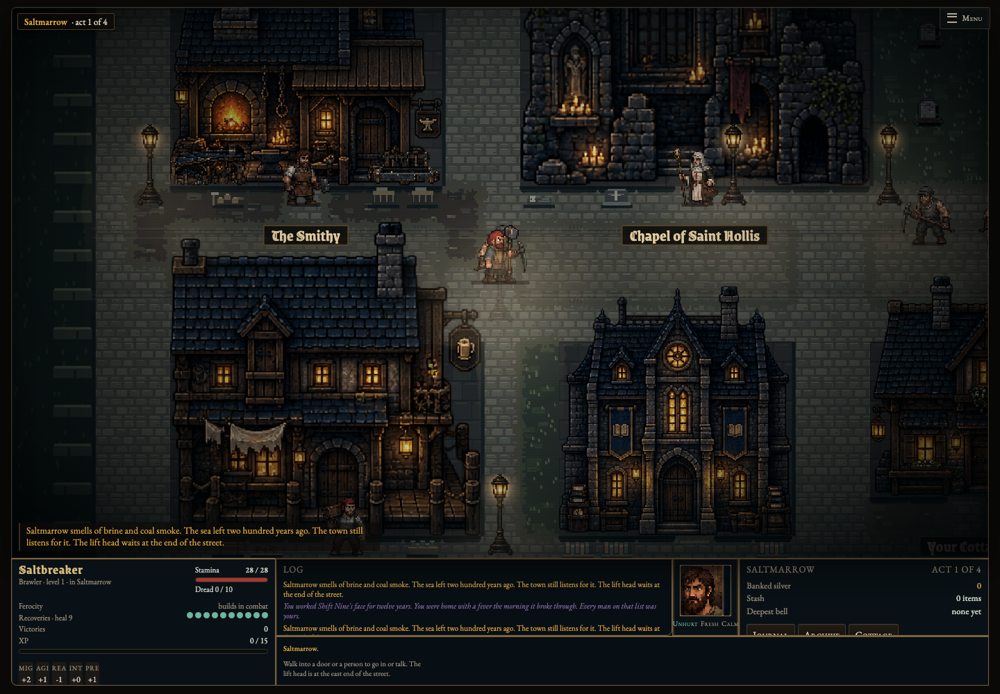 |
| Mine | 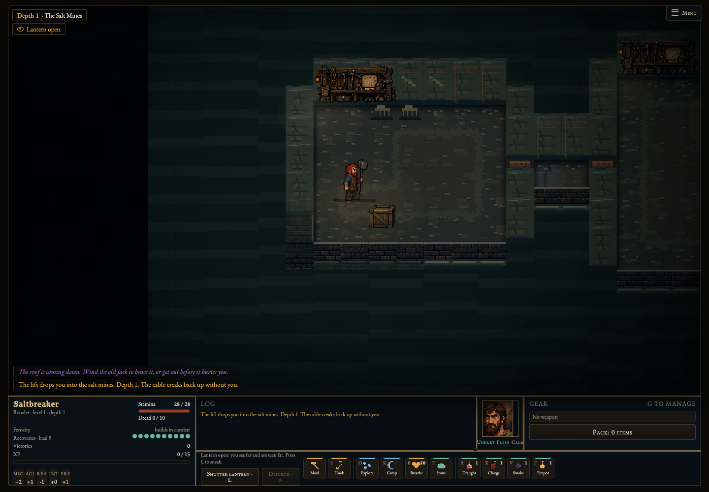 | 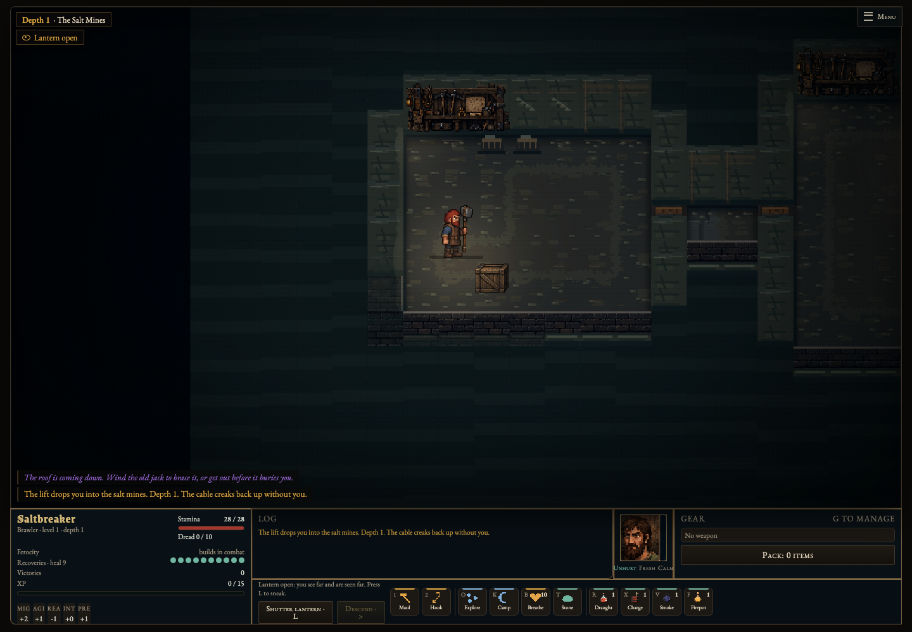 |
| Crypt | 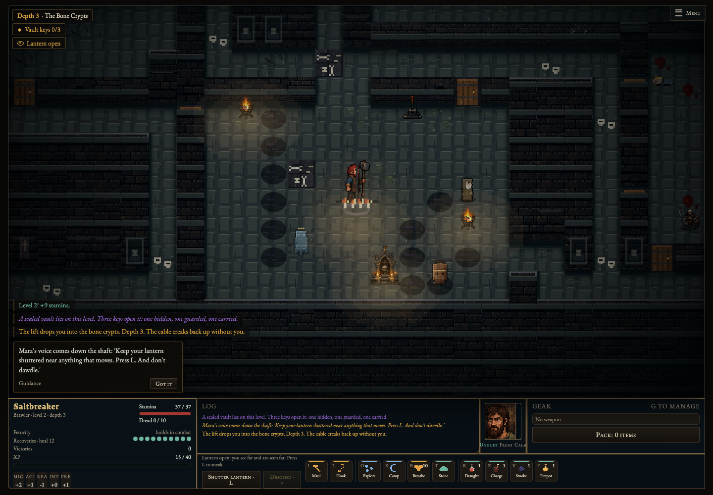 | 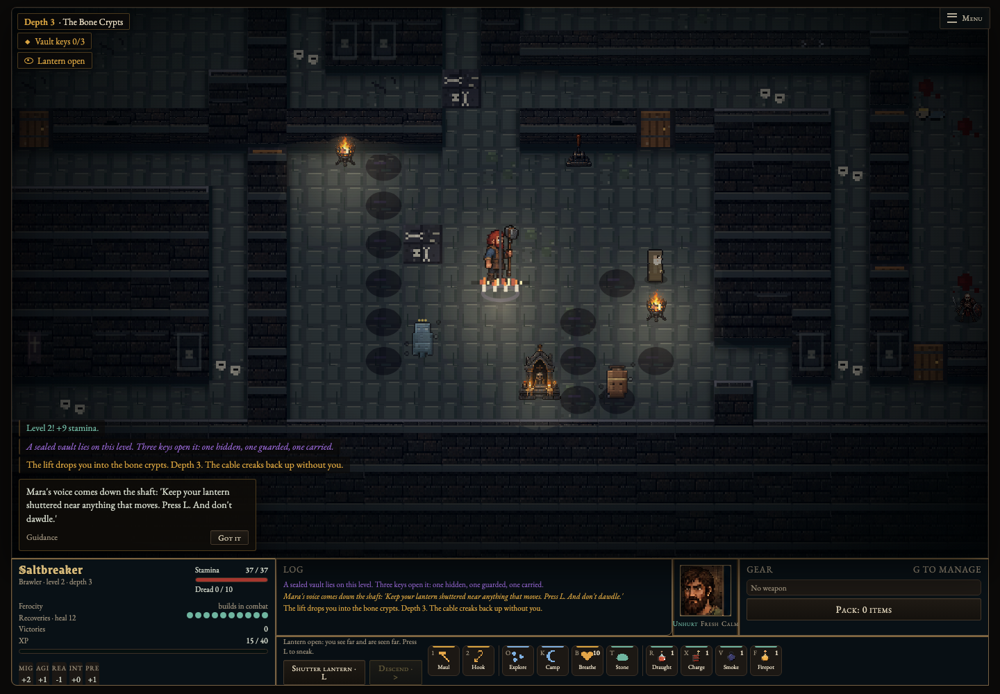 |
| Fungal | 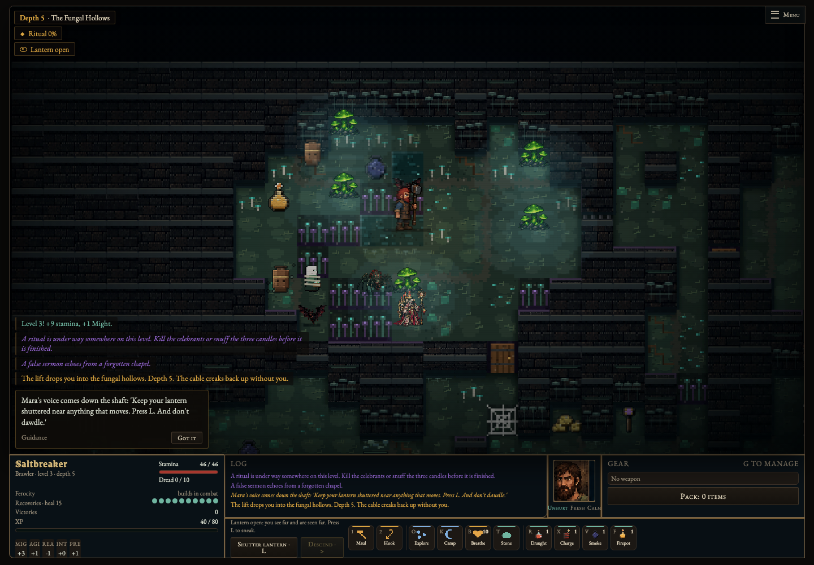 | 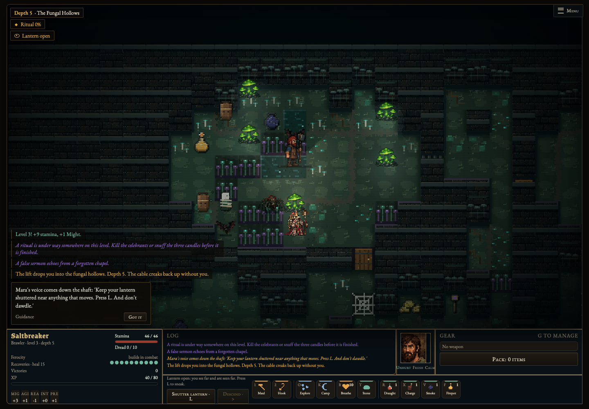 |
| Drowned | 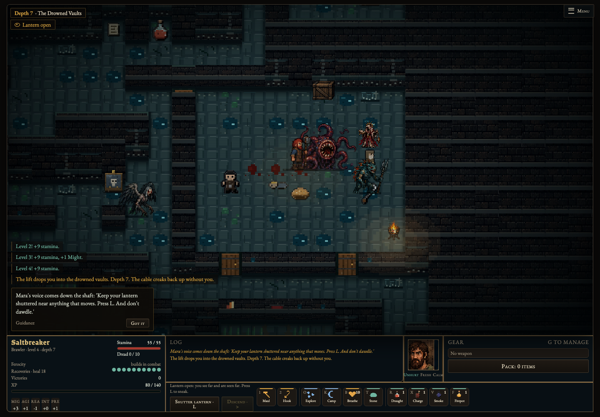 | 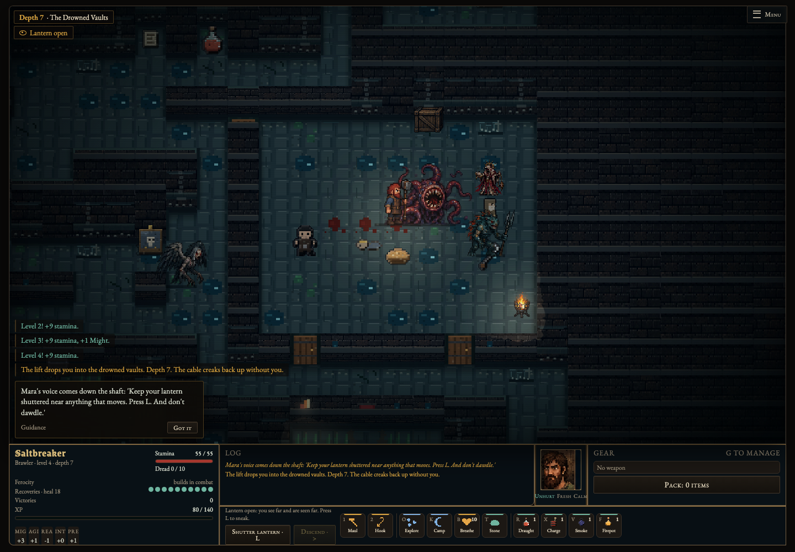 |

Normal gameplay visibility (new renderer):

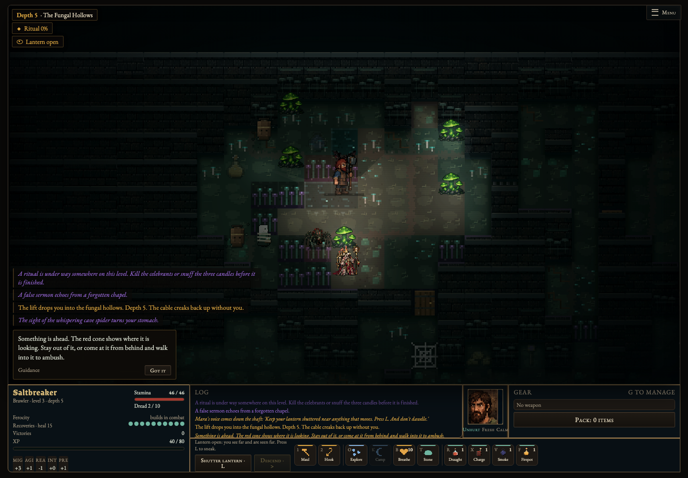

The grid still determines movement, cover, shadows and visibility. This pass softens visual illumination and memory transitions; it does not change those tactical rules.
