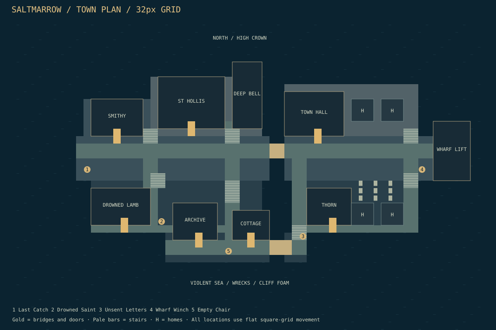
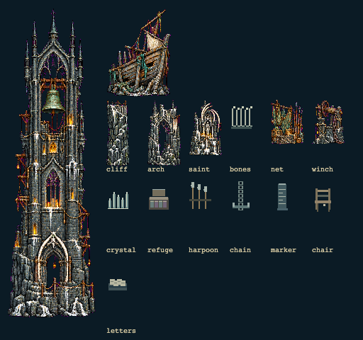
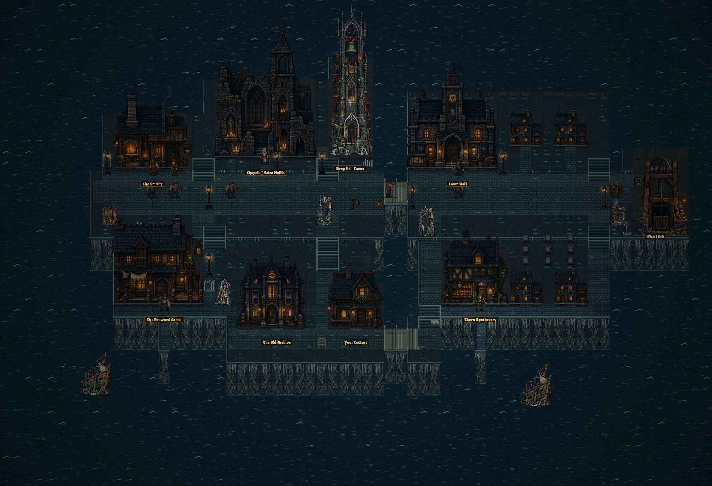
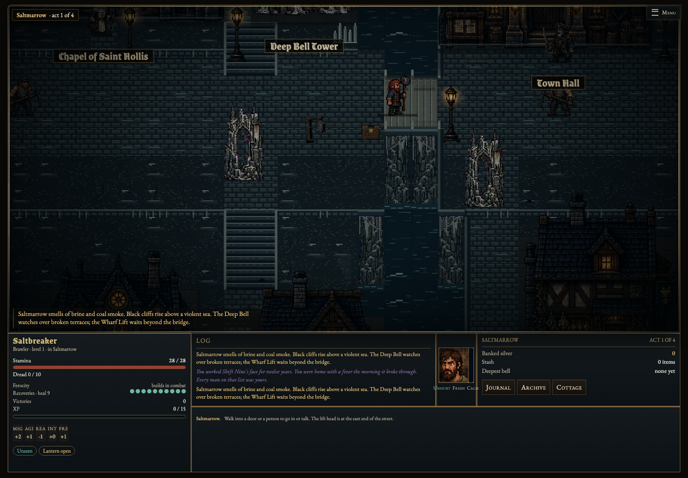
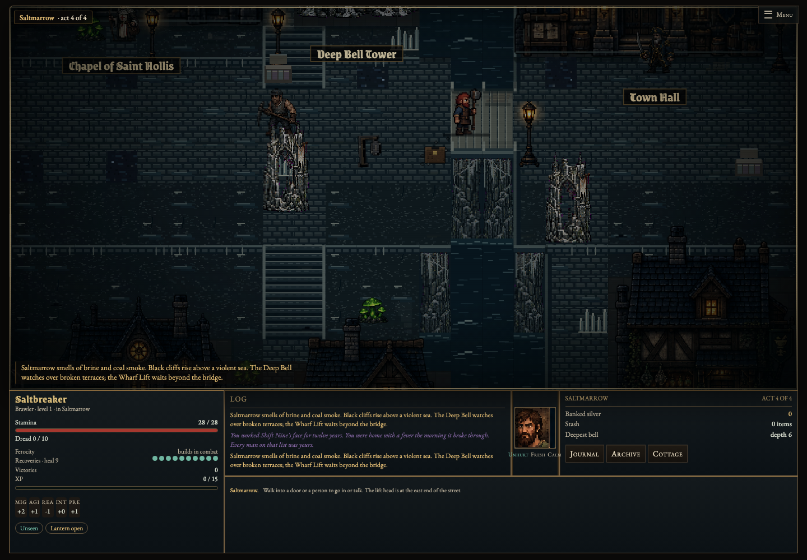
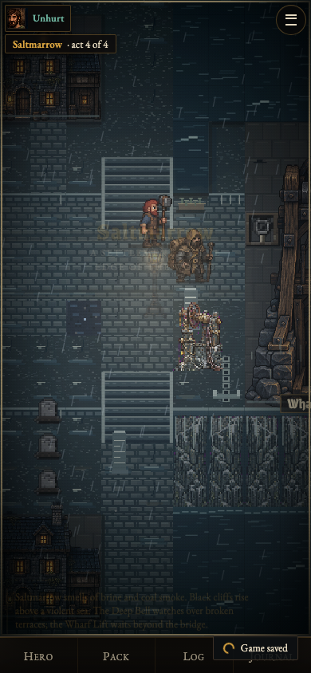

# Saltmarrow: the cliff settlement

The hub now inhabits the same black-cliff coast as the active title art (`assets/flat/home.webp`). A narrow tide cleft separates two inhabited promontories. The Deep Bell Tower stands over the west bridgehead; the chapel and hall occupy older upper masonry. Work terraces lead down past patched homes to sea-facing balconies and wrecks. Cold blue stone, mineral runoff and wet paving surround the existing warm gothic facades.

The game remains an axis-aligned **32 × 32 pixel square grid**. Elevation describes the scenery, not a second coordinate system: stairs cost ordinary movement, picking remains exact, and sprites remain upright. Sea and uncarved cliffs are solid map cells. Two explicit bridges cross the cleft. No isometric projection, invisible height penalty, or camera zoom change is introduced.



## Complete layout

Coordinates are zero-based tile coordinates, `x` east, `y` south. Rectangles use `x, y, width, height`. The full map remains 63 × 43; the settlement envelope is x8–60, y5–31. Each building retains its distinct existing facade and interior, with a new salt-weathering pass.

| Landmark | Footprint | Exterior approach | Role and architectural story |
|---|---|---|---|
| Deep Bell Tower | 29,5,4,9 | 31,14 | Dominant warning tower; bronze bell, mineral-streaked buttresses, repaired gatehouse and bone lintel. Inspect its base for act-specific writing. Dungeon bell mechanics remain at dungeon bells. |
| Chapel of Saint Hollis | 19,7,9,7 | 23,14 | Older ruined religious stonework above the working town; saint niche, candles and patched arches. Agathe and chapel services remain. |
| Town Hall | 36,9,8,6 | 40,15 | Authority on the eastern high terrace, above the lottery box and bridge; surviving clock and civic banner. Hale's training and story remain. |
| Smithy | 10,10,7,5 | 13,15 | Coal-stained terrace carved under the chapel shelf. Existing coal/quench workyard compositions, chimney smoke and harpoons connect mining to coastal repairs. |
| Drowned Lamb Tavern | 10,22,8,5 | 14,27 | Lower western refuge, ship timber repairs, glowing windows and smoke above the net-drying ledge. Bram and tavern services remain. |
| Old Archive | 21,24,6,5 | 24,29 | Ruined civic building reused to preserve records; its balcony route leads toward bundles of unsent ships' letters. |
| Player Cottage | 29,25,5,4 | 31,29 | Last small home beside the lower bridge; a sea-facing empty chair tells a personal story without adding a quest. Bed, stash and hearth remain. |
| Thorn Apothecary | 39,22,6,5 | 42,27 | Eastern lower terrace, surrounded later by pale growth. Remains boarded until Nell is freed. |
| Wharf Lift | 56,13,5,8 | 55,16 → gate 56,16 | Winch house at the eastern bridge route, anchor chains, tide gauge and rope machinery. Existing delve/loadout interface remains. |
| Four repaired homes | 45,10,3,3; 49,10,3,3; 45,24,3,3; 49,24,3,3 | 46/50,13 and 46/50,27 | Houses board up through the acts; each retains a reachable approach. |
| Salt graves | x46/48/50, y21/22/23 | Eastern lower lanes | Nine empty miners' graves, between the upper houses and lower shelter. |

### Terraces and routes

The geometry is authored as overlapping carved shelves, followed by building footprints and door approaches. This table is the complete base shelf inventory; links, bridges and the lift annex extend it.

| Shelf | Rectangle | Scenic elevation |
|---|---|---|
| West crown | 18,7,15,9 | 3 |
| East crown | 36,8,18,8 | 3 |
| Smith ledge | 9,10,9,6 | 2 |
| Working terrace | 8,15,48,6 | 2 |
| West lower borough | 10,21,23,7 | 1 |
| East lower borough | 37,21,17,7 | 1 |
| Cottage balcony | 20,28,19,4 | 1 |

The cleft removes x34–35 from y5–31. Only the upper bridge (34,16,2,2) and lower bridge (34,29,3,2) cross it. A clear two-tile main route at y16–17 connects the lift, both bridgeheads and service alleys. Northern frontages are at y15; southern service lanes run at y27 and y29–30. Longitudinal links use x17–18, x28–29, x37–38 and x52–53, with one-tile building approaches. Upper and lower houses join these lanes through short frontages.

The seven authored stair rectangles are **17,14,2,2; 28,14,2,2; 52,14,2,2; 18,20,2,2; 28,21,2,3; 52,20,2,2; 37,27,2,2**. Retaining courses frame the terrace boundaries and leave the stair panels open. Scenery fades when it would cover the player.

## Elevation diagram

This is a scenic section, not a change to the tactical projection or world scale.

```text
                              DEEP BELL
                                 /|\
                           [ bronze bell ]
                CHAPEL        |       |       TOWN HALL
   crown 3  ____/______\_______|_______|__      ___/____\____
                     stairs   | tide  | stairs
   ledge 2  SMITHY ==== working bridge ======== WHARF LIFT
                      retaining walls              ||
                        stairs                     || into depths
   ledge 1  TAVERN -- ARCHIVE -- COTTAGE == lower bridge == THORN
             balcony    letters   chair            graves/homes
               |  black basalt  |      |  black basalt  |
   sea 0   ~~~~wreck~~~~~~~~~~~~~|~~~~~~|~~~~~wreck~~~~~~~~~~~~
```

## Environmental storytelling

Six nonblocking inspectable landmarks use the normal right-click / long-press inspection UI. Their visual props occupy the same scene or its immediate frontage.

| Tile | Scene | What the player discovers |
|---|---|---|
| 31,14 | Deep Bell Tower | Four act-specific descriptions: polished warning ropes → new tide mark → unattended bell and fungal mortar → evacuation preparations. |
| 9,19 | The Last Catch | Nets, baskets and harpoons; a fishing ledger ends in a drawing of a human hand. |
| 19,26 | The Drowned Saint | A salt-white saint under whale ribs; candles are renewed, but nobody cleans its face. |
| 38,28 | The Unsent Letters | Old boat planks reinforce a balcony beside letters addressed to vanished ships. |
| 54,19 | Wharf Lift | Rope winch, anchor chains and tide markers record water rising inside the shaft. |
| 28,30 | The Empty Chair | A lone chair faces the sea: one cup, two coat hooks, a mining helmet full of rain. |

Sea views are exposed around the promontories and through the central cleft. Rain, drifting fog, existing lantern pools, warm facade windows, chimney smoke, perched crows, foam at the cliff foot and shipwrecks establish a lived-in coast. Ruined gateways, bone lintels, salt crystals, pale runoff and uneven masonry carry the older layers of settlement.

## Acts 1–4

Existing story flags and service progression remain authoritative. The hub takes its act from the existing deepest-depth story progression; the exterior refreshes on entering town or exiting a service.

| Act | Town state | Playable progression |
|---|---|---|
| 1 — Holding the line | Working lamps and warning ropes; nets dry on the ledge; bell bronze is polished by use. | Meet the town, use the original seven services, and descend through the Wharf Lift. Thorn remains closed until Nell is rescued. |
| 2 — The tide remembers | Another home boards up; fewer residents remain; fresh tide marker and extra mineral growth appear near the bridge. The bell stair gains a higher tide mark. | Existing rescue and quest flags continue; bridge and service access remain intact. |
| 3 — What grows below | More empty homes; fewer tavern patrons; existing fungal intrusion spreads, supplemented by pale crystals on the lower approaches. The bell rings without a keeper. | Deeper expeditions and the existing lottery/authority story continue; no shop or bridge is lost. |
| 4 — A season, perhaps less | Three homes boarded (a fourth can close through existing bribery consequences); street population declines; water enters gutters. Refuge blankets and supplies appear at upper bridgeheads. | The town prepares to evacuate while preserving the full service loop and safe path to the lift for the final expeditions. |

## Required tiles, props and pixel assets

The reusable coastal kit is implemented in `town-coast.js`; its cached canvases are the runtime source. `sprite(kind, variant)` exposes independent transparent sprites for reuse/export. The committed PNGs in `assets/coast/` are native-resolution exports for art tools. The detailed generated atlas is separately loaded and cropped by the module; the hand-authored sprites remain a loading/offline fallback.

| Asset group | Runtime assets / variants | Use |
|---|---|---|
| Wet basalt paving | 32px, 16 seeded variants per lane/elevation combination | Small irregular stones, cracks, damp glints and coherent materials instead of broad repeating ground. |
| Broken yard stone | 32px, 16 seeded variants per elevation | Gravel, mineral chips and runoff outside the lanes. |
| Cliff / seawall | 32×96, six deterministic variants | Fractured dark rock, salt streaks, retaining masonry and foam contact. |
| Stair flights | Native 32px grid panels, arbitrary authored width/length | Chipped treads, low parapets and riser shadows. |
| Bridge deck | Native 32px grid panels, two authored spans | Reclaimed boards, side rails and mooring posts. |
| Sea / foam | Animated stepped glints and shoreline foam; frozen under reduced motion | Continuous blue-black coastal water and tide cleft. |
| Deep Bell Tower | 128×320 fallback, 128×448 detailed atlas variant | Belfry, bell, pinnacles, warning rope, salt masonry and bone gate lintel. |
| Shipwreck | 160×96 fallback, detailed atlas variant | Fishing boat hull, snapped mast, ribs and rigging. |
| Ruined arch | 32×64 fallback, detailed atlas variant | Reused ancient gateway. |
| Drowned saint | 32×48 fallback, detailed atlas variant | Saint shrine and candles; whale ribs available separately. |
| Rope winch | 32×48 fallback, detailed atlas variant | Wharf machinery. |
| Fishing nets | 32×48 fallback, detailed atlas variant | Working coast frontage. |
| Whale bones, harpoons, anchor chain, tide gauge | 32×48 each | Coastal and mining history. |
| Salt crystals, refuge supplies, empty chair, letters | 32×48 each | Act progression and inspectable stories. |
| Existing seven landmark facades, four homes, lift | Existing `assets/flat` art plus salt/rain/smoke/crow overlays | Preserves detailed building identities and consistent human scale. |



## Save compatibility and verification

Town layout version **3** migrates older exterior saves using the existing migration path. Player statistics, equipment, bag, gold, quests, story and meta progress are retained; dropped items move to reachable tiles if necessary. The nearest-floor search now spans the complete new settlement. Interiors and dungeons are not regenerated by this migration.

`npm test` passes **105 tests** and covers all existing systems plus 120 seeded four-act towns, service/house/NPC access, the two bridge cells, blocked cleft, all interior exits and legacy migration. `npm run test:coast` uses real exploration steps with collisions and NPCs enabled: it crosses both bridges, walks all service approaches in every act, checks the sea is blocked, verifies the six story landmarks and inspects the bell, checks drawing does not change simulation state, and captures desktop/mobile views. `npm run test:environment` additionally clicks into all seven services and returns outside, exercises legacy resume, and checks all biome renderers.

The environment CI workflow runs the coastal browser suite and uploads screenshots. Offline web caches and both native application bundles include the new module and asset atlas.

## Review images



| Act 1 | Act 4 |
|---|---|
|  |  |



The detailed atlas was generated for this project using the imagegen skill, then packed into native pixel canvases with nearest-neighbor sampling. The shipped source uses a magenta color key, converted to alpha before packing; sprite PNG exports have actual transparent backgrounds. Intermediate opaque-background generations are not shipped. No network image service is required at runtime. The atlas and all runtime code are bundled for offline play.

Measured on the local headless Chromium host: the fully composed town averaged approximately **58 ms per complete draw** in the environment suite's 30-frame sample (other biomes approximately 7–10 ms). This is a performance baseline for review, not a frame-rate target assertion. The fully revealed exterior uses a single lighting clip and does not render hidden masonry beneath the sea; facade rendering and light compositing remain shared with the existing renderer.
