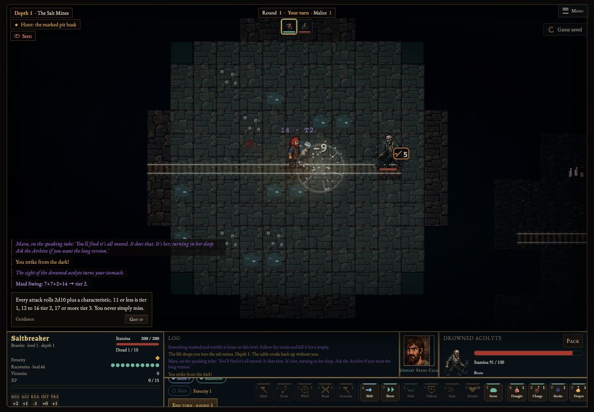
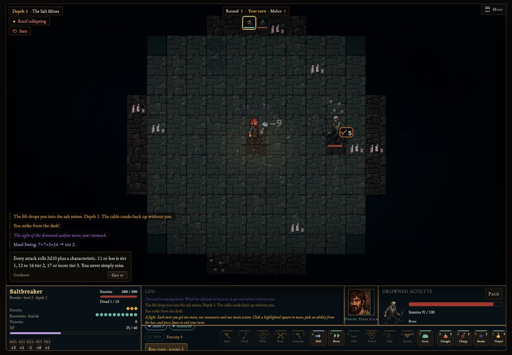
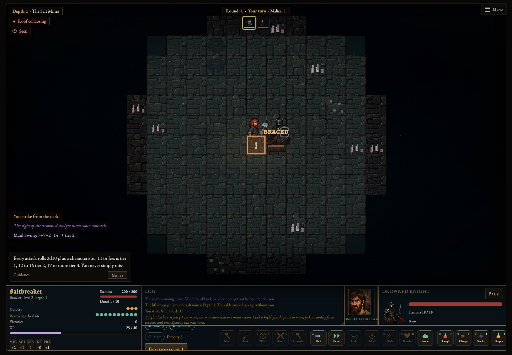

> Current follow-up: full-body miner maul poses, exact mirrored side walking, held input and first-round guard responses. Earlier recordings below document the first pass; [new pose evidence](body-art/full-body-poses.png) and [art notes](full-body-art.md) document the current change. Human animation-quality review is still pending.

# Movement and combat feel review

Direct playtest feedback: grid movement felt clunky; animations and fights passed too quickly to read; battles should feel impactful and dangerous.

This branch starts from main `9bf5a8a`. It retains the flat pixel art, turn-based grid, movement costs, occupancy, pathfinding, actions, existing factions and equipped-weapon hooks. No real-time combat or new projection is introduced.

## Result

- Each ordinary tile step interpolates from its actual rendered position to its authoritative grid destination in 145 ms at normal pace, with a smooth start/stop and exact arrival. Strides and held-weapon motion follow that step rather than the global animation clock. Click paths stop on the existing threat/obstruction rules; redundant click-path waits are removed.
- Attack profiles have distinct anticipation and travel/contact, a 90 ms contact hold, reaction and recovery. Normal profiles last roughly 0.7–1.0 s before any death settling. The wrapper keeps input locked until the beat finishes, including nested/free attacks; inputs do not accumulate an attack backlog.
- Weapon/body contact and primary impact effects use the actual damage event. Area bursts wait for contact, delayed resolution holds the effect, and enemy strikes share the same contact clock. Existing hit/death sounds still originate from the real hit/death events. Fast/instant settings scale the timeline and primary effects; reduced motion snaps movement and omits the contact hold and extra death settling.
- Drowned Knights and Spore Walkers commit a marked tile before a heavy slam, brace against 3 frontal damage while preparing, then recover for a turn. Moving clear, flanking, displacement and daze provide counterplay. Standing in the mark adds 3 damage to the existing attack tiers. Extra attacks cannot skip the warning. Enemy HP is unchanged.

The initial pass added interpolation to existing poses. After direct user review rejected the static-body/hand-only result, the current follow-up adds an actual full-body miner walk/heavy-maul atlas. See [full-body art notes and scope](full-body-art.md). Footstep sounds retain the existing accepted-step trigger. Cosmetic death debris may persist after input returns.

## Before / after evidence

The browser fixture uses the same seeded room, equipped maul and controlled tier-2 roll. Baseline serves main's original HTML, `flat-art.js` and `animation-art.js`. Videos show actual browser execution, including the fixture reset between checks. Screenshots alone cannot show pacing.

| Main | This branch |
| --- | --- |
| [Desktop recording](before.webm) | [Desktop recording](after.webm) |
|  |  |
| [Timing/state capture](before-metrics.json) | [Timing/state capture](after-metrics.json) |

The main fixture returns while the held weapon still reports `recover`; this branch returns in `idle`. The normal maul action changes from about 0.65 s to about 1.3–1.4 s on this Mac. These are observations, not frame-time guarantees. The automated midpoint/arrival check verifies identical positions at 60 and 144 Hz.



## Provisional encounter tuning

Twenty-four seeded depth-3 mixed encounters (Knight + Sailor + Sapper), twelve each for Riptide and Shadow, use a fixed basic policy: dodge a committed warning when possible, approach and use the default attack. Both versions use the same seeds and unchanged monster HP. This intentionally limited policy does not use healing, advanced abilities or gear optimization.

| Measure | Main | This branch |
| --- | ---: | ---: |
| Median meaningful hero turns until victory/defeat | 4 | 6 |
| Range | 3–7 | 4–7 |
| Survivals | 7/24 | 21/24 |
| Median stamina lost | 48.5 | 34.5 |
| Twenty-turn stalls | 0 | 0 |

The stronger survival rate reflects readable counterplay rather than extra HP. It also means this is not evidence of universally harder encounters. The provisional 5–9-turn target is a tuning guide; individual quick wins and defeats remain valid. [Raw baseline](encounters-before.json) / [raw branch](encounters-after.json).

## Verification and compatibility

- 71 automated tests pass, including movement destinations/costs, telegraph commitment, interruption, displacement, bleeding, guard counterplay, contact hold and seeded encounter guardrails.
- Desktop Chromium on macOS: new feel suite, equipped weapons, tactics, native animations (normal/reduced), flat projection and ordinary gameplay pass. The feel suite checks 60/144 Hz interpolation, exact arrival, rejected overlapping attack input, unchanged turn number, hero/enemy damage contact, burst contact, recovery, three speeds, killing-blow lock and reduced motion. CI uploads its recordings and screenshots.
- A separate local combination with UI PR #29 and environment PR #28 passes 80 tests plus feel, UI and environment browser suites. Gameplay/rendering hunks merge cleanly after moving this branch's hooks beside actor rendering. Shared `sw.js` cache revision and the UI/environment package-script additions require mechanical reconciliation; retain all environment CORE assets and all test scripts. The independent feel CI workflow avoids edits to their renderer workflow.
- Combat PR #25 and weapons PR #27 were already merged into the base. The compatibility combination was tested separately; neither pending branch was modified or incorporated into this PR.

The follow-up suite also passes in Playwright WebKit 26.5 on macOS, including normal/reduced motion, actual arrow-key presses, repeated keydown/release, turning, projected mouse clicks and path cancellation. This is Safari-engine coverage, not verification of the installed Safari application. Human keyboard/mouse feel review remains outstanding. No native desktop build, deployment or merge is claimed. Human review should especially assess heavy-enemy threat frequency, the substantially improved survival rate, held-key feel and whether normal recovery is too long in larger encounters.

## Reproduce

```sh
npm ci
npx playwright install chromium webkit
npm test
SCREENSHOT_DIR=test-results/feel npm run test:feel
BROWSER=webkit SCREENSHOT_DIR=test-results/webkit npm run test:feel
npm run test:weapons
npm run test:tactics
node tests/animation-browser.cjs
node tests/flat-browser.cjs
npm run test:browser
FEEL_REPORT=test-results/encounters.json node --test tests/feel.test.cjs
```

For baseline comparison, save `git show 9bf5a8a:index.html` as `before-feel.html`, with `before-flat-art.js` and `before-animation-art.js` alongside it from the same commit. Set `FEEL_BASELINE` to that HTML when running `tests/feel-browser.cjs`; set it for the `seeded mixed` test to generate baseline balance data. `CHROME_PATH` can select an installed Chromium executable.

## Follow-up: input and final-frame validation

The actual-input checks exposed a timer/render boundary: a recovery wait could return just before the last animation frame. Input release now waits for the next rendered frame when necessary, with a 50 ms fallback so a hidden or stalled renderer cannot create an indefinite wait. Opportunity strikes are checked to return with the weapon in its idle pose.

Both macOS browser engines passed the expanded suite. The repeat-key fixture advanced four tiles, stopped on key release without queued movement, and Escape stopped a projected mouse path after its first tile. [Chromium capture](chromium-input-metrics.json) / [WebKit capture](webkit-metrics.json). CI runs Chromium on Ubuntu and WebKit on macOS (the target platform), saving each recording separately. The rendered-arrival check waits for an actual browser frame, separately from the deterministic 145 ms/60 Hz/144 Hz interpolation assertions; this avoids assuming the Linux software renderer paints within a fixed wall-clock delay.

The follow-up CI run also exposed an existing unseeded Hollow Faith placement test failing in one job while passing in others. Its twelve map fixtures now use reported seeds 1–12 with all reachability/boss-preservation assertions intact. This stabilizes regression reproduction; it does not change faction placement or establish that every possible generated layout contains the optional Saint.
