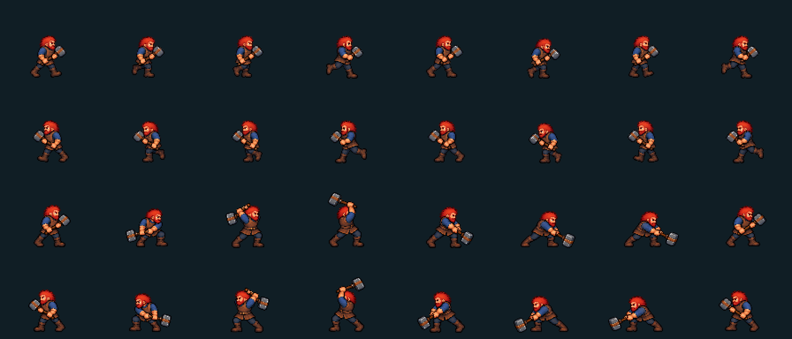

# Full-body miner animation follow-up

Direct review feedback: the previous strike looked like a static character moving one hand, and right-to-left walking looked wrong. The equipped-body path deliberately selected resting/walk bodies to remove the baked maul; procedural weapon movement consequently did not animate the torso and legs. Adding sprite offsets did not fix that structural limitation.

This follow-up replaces the miner's default heavy maul body with authored full-body pixels. Eight side-walk poses and eight heavy-strike poses are packed into a fixed-foot-anchor atlas; west-facing pixels are exact mirrors of east-facing pixels. The strike bends the knees, loads the hips/shoulders, raises both arms, transfers weight into contact, follows through and recovers. The integrated maul disables the separate hand/weapon pass, bob, hop and generic lunge on this path. North/south use the existing authored body/maul poses.

**Scope:** new full-body pixels cover Riptide + maul + heavy attack family. Other weapons and non-heavy ability families retain their swappable renderer and choreography; these are not claimed to have new full-body sheets. The separate weapon-art PR #31 exposes `profile.bodyFamily` and delegates recovery to FEEL. Both PRs remain unmerged pending combination and human review.

## Files and validation

- `miner-body.js`: pure pose sampler + atlas loading; reads t0/impact/hold/end and never changes damage, actions or movement costs.
- `assets/flat/miner-body-packed-v1.png`: runtime atlas, 8 columns × 4 rows, 112×96 cells. Ground baseline 88; last 8 pixels retain low maul follow-through below the boot plane.
- `assets/flat/miner-body-side-v1.png`: generated source, walking row only is consumed.
- `assets/flat/miner-maul-body-source-v1.png`: separately generated 4×2 attack source with sufficient spacing.
- `assets/flat/miner-body-v1.json`: exact source bounds, anchors, scales, and SHA-256 hashes.
- `tools/pack-miner-body.py`: deterministic alpha-component extraction, fixed per-sheet scale, boot/head anchors and exact west mirroring. No painting or synthesized limb motion. Requires Pillow.

Two earlier generated arrangements were rejected for inconsistent facing or touching weapon/sprite boundaries. The selected sources are packed by connected components instead of naive cell slicing. Every runtime pose has nonzero padding and no clipping. The raw sources are retained for provenance; only the compact packed atlas is cached for play.

Browser checks in Chromium and WebKit verify eight distinct walking and attack images, changing lower-body silhouettes, every mirrored pixel, reduced motion, equipment/family fallback and suppression of the detached weapon pass. Existing hit/death and turn-resolution checks remain in place. Passing those checks is not a substitute for the user's animation-quality review.

## Related feel changes

Held keys now drive consecutive accepted steps without the operating system's initial repeat delay. One tapped direction can be buffered while a step completes; key release, Escape, blur and modal/phase changes stop held movement. Combat movement retains its budget and does not advance the round or automatically attack an enemy reached by holding a direction. Tile interpolation has constant travel speed instead of stopping and easing at every cell.

The default heavy maul profile now lasts about 1.3 seconds at normal speed, with a 90 ms contact hold and damage/effects synchronized to the existing damage event. Only the directly ambushed target is surprised; nearby guards can respond in the opening round. Monster HP is unchanged. Optional real-time exploration drains due world updates between accepted steps so holding movement cannot starve the world ticker.

## Generation method and selected prompt set

Used the built-in image-generation tool with a genuinely transparent background. Reference files were the existing miner action atlas and then the selected same-character side-view source. Sources were saved non-destructively as sibling versioned assets. No external API/CLI image-generation fallback was used.

### Side-view source prompt

Production pixel-art GAME SPRITE SHEET. Match the red-haired red-bearded stocky miner in the reference EXACTLY: navy rolled-sleeve shirt, brown leather apron/vest and belt, dark trousers, chunky brown boots, square steel maul with wooden shaft. Same detailed flat pixel art and slight overhead view as reference, no redesign. NEW poses. Output a wide image, exactly TWO ROWS, EIGHT COLUMNS per row, 16 sprites total, evenly spaced in equal cells with generous transparent padding. Entire image genuinely transparent. NO labels or dividers or shadows or effects. EVERY SINGLE SPRITE FACES RIGHT/EAST throughout BOTH rows: nose/beard to the RIGHT, back to the LEFT. NEVER show the character's back or turn toward the viewer. Consistent standing body height, pelvis center and fixed foot baseline across cells, absolutely no cropped feet, weapon or hair. Row 1 is an 8-frame seamless WALK CYCLE facing RIGHT: right-foot contact; down/recoil; feet passing; high/raised rear foot; opposite left-foot contact; down/recoil; passing; high. Real distinct alternating legs and bent knees, slight counter-rotation of hips/shoulders, maul carried naturally at the chest. Different full-body poses in every frame, no repeated idle sprites. Row 2 is an 8-frame FULL-BODY TWO-HANDED MAUL ATTACK facing RIGHT. Col1 ready balanced stance with both hands on the haft, col2 bends knees and coils hips backward with maul low, col3 raises maul behind RIGHT-FACING head while torso twists back, col4 full high/back wind-up with shoulders loaded and back knee bent, col5 steps forward and uncoils hips as the maul swings downward/forward toward RIGHT, col6 CONTACT with maul LOW AND FAR RIGHT, BOTH hands on shaft, front leg bent/braced and torso driven forward, col7 low follow-through with hips/knees absorbing force, col8 recovery toward ready. The miner must visibly move his WHOLE body: legs, pelvis, spine/shoulders and both arms through every attack pose. The head continues facing RIGHT in every cell. NOT static torso or one moving hand. Maul follows a coherent overhead arc, correct two-handed grip, no dislocated limbs. No rotation to a back view during wind-up. Strong readable poses connected smoothly, no motion blur, no antialias blur, no ghosting. Preserve same pixel-art character proportions and colors; do not turn into 3D, anime or isometric. Canvas about 2048x512, each cell about256x256, fully transparent margins on all sides. Frame anchor centered x128 per cell, ground baseline y228, torso standing height about160px so lifted maul fits above without clipping.

Only the walk row was accepted from that source. Its crowded attack row was replaced with the following separate sheet.

### Selected attack prompt

Create a clean game-ready sprite atlas of ONLY THE RIGHT-FACING MAUL ATTACK from the reference, same exact red-haired red-bearded stocky miner, navy shirt, leather apron, brown boots, steel maul, same flat detailed pixel-art style and proportions. Eight full-body attack frames. Arrange EXACTLY 4 COLUMNS and 2 ROWS, read left-to-right top row then left-to-right bottom row. Square canvas 2048x2048, equal 512x1024? IMPORTANT use square equal cells: canvas2048x1024, 4x2 cells512x512, wide2:1. Keep EACH character plus entire weapon well inside its own cell with AT LEAST 70 pixels of fully transparent padding on all four sides. No two characters or weapons may touch, overlap or cross cell boundaries. Do NOT make a tightly packed sprite sheet. Genuinely transparent background, no floor/shadows/grid/text/effects. Same scale EVERY frame; body height about260px, ground foot baseline y420 per512cell, pelvis centered x230; space to RIGHT for extended maul. Character faces RIGHT/EAST in ALL eight frames, never back view. Full-body motion, BOTH hands gripping long haft, shifting braced feet, knees, hips, torso, shoulders and arms, not static torso + single moving arm. Frame1 ready upright two-handed guard. Frame2 bent-knee backward load, maul lowered to left/back. Frame3 hips twist back and maul rises behind head. Frame4 fully raised overhead wind-up with body coiled and shoulders loaded, head still faces right. Frame5 driving forward weight transfer, torso uncoils, arms and maul descending toward right. Frame6 CONTACT: maul head low and well to right, both arms extended, front knee braced, body leaning forward. Frame7 follow-through low to right, knees absorb force and shoulders continue through arc. Frame8 recovery toward ready guard. Preserve costume, face, outline weight, pixel shading, head size and body scale in all eight. Crisp native pixel edges, no blur, no ghosting, no captions. Padding is critical: weapon remains at least70px from every cell edge even at maximum extension. Avoid missing maul heads or detached sprite fragments. This is an animation sequence, not a pose chart with different characters.
