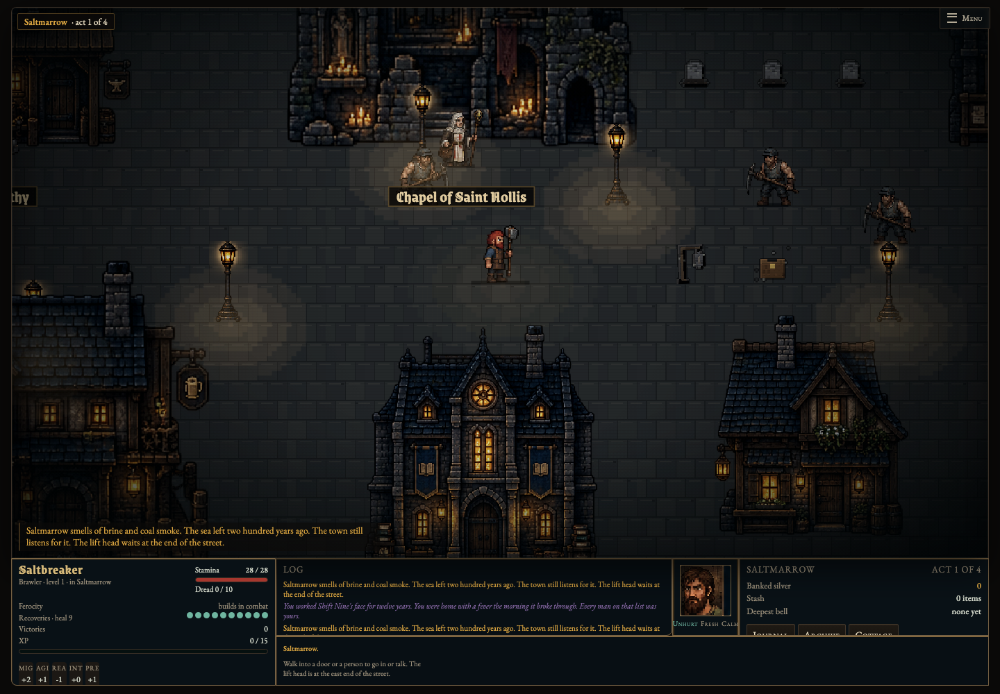
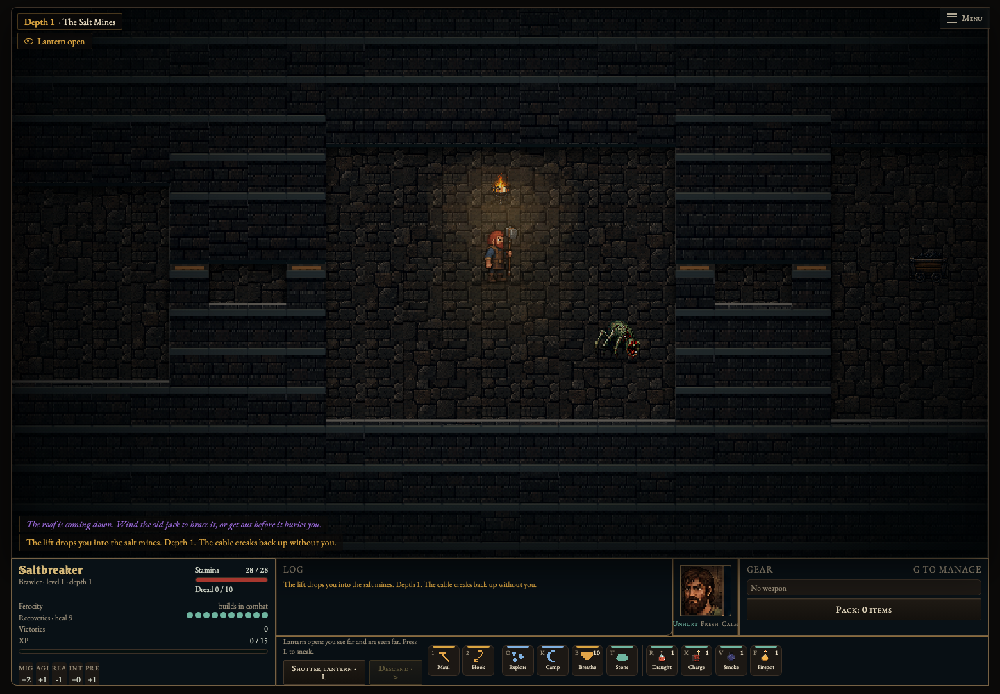
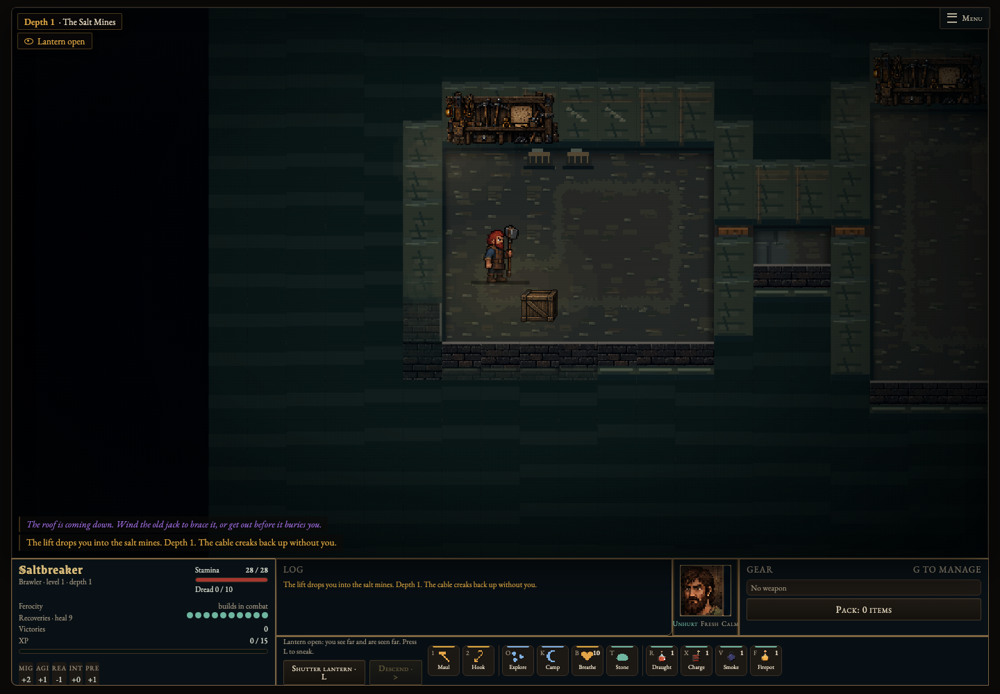
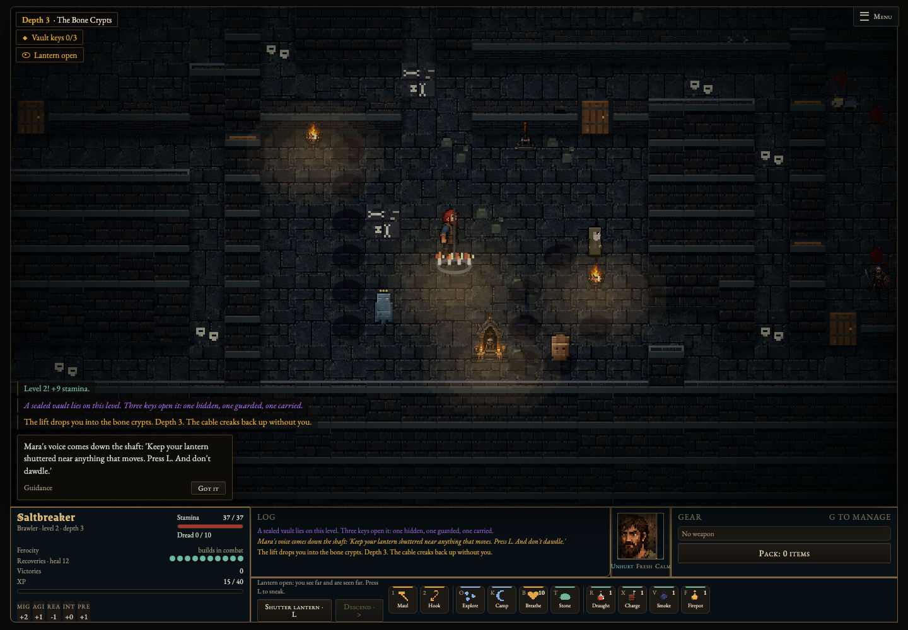
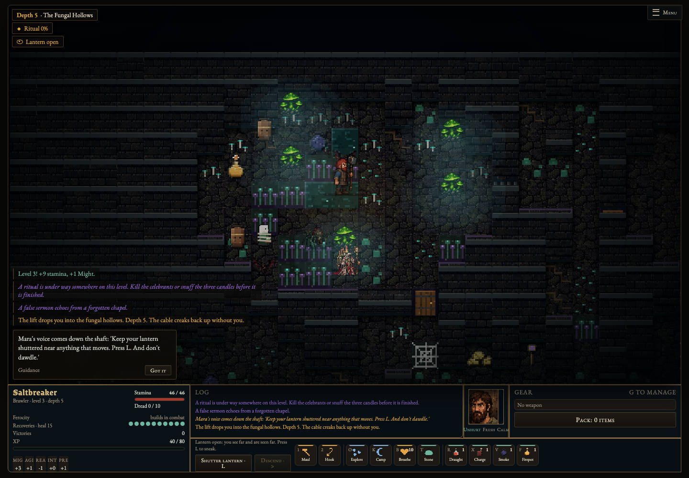
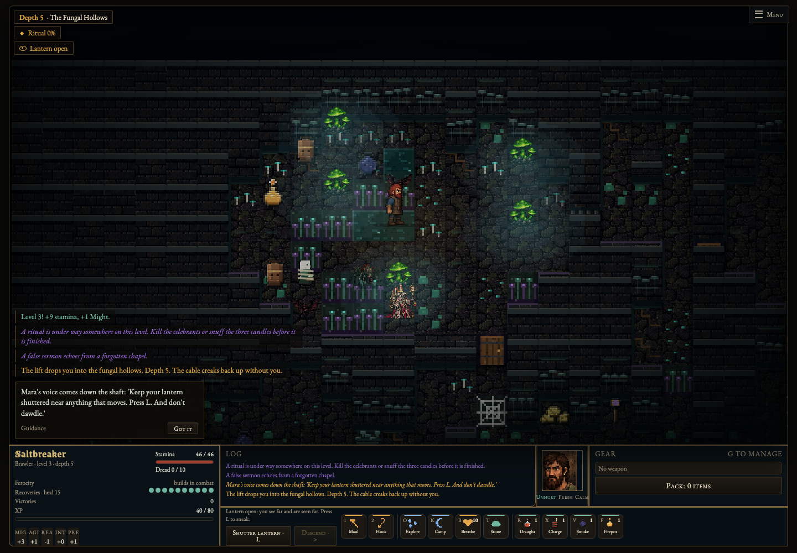
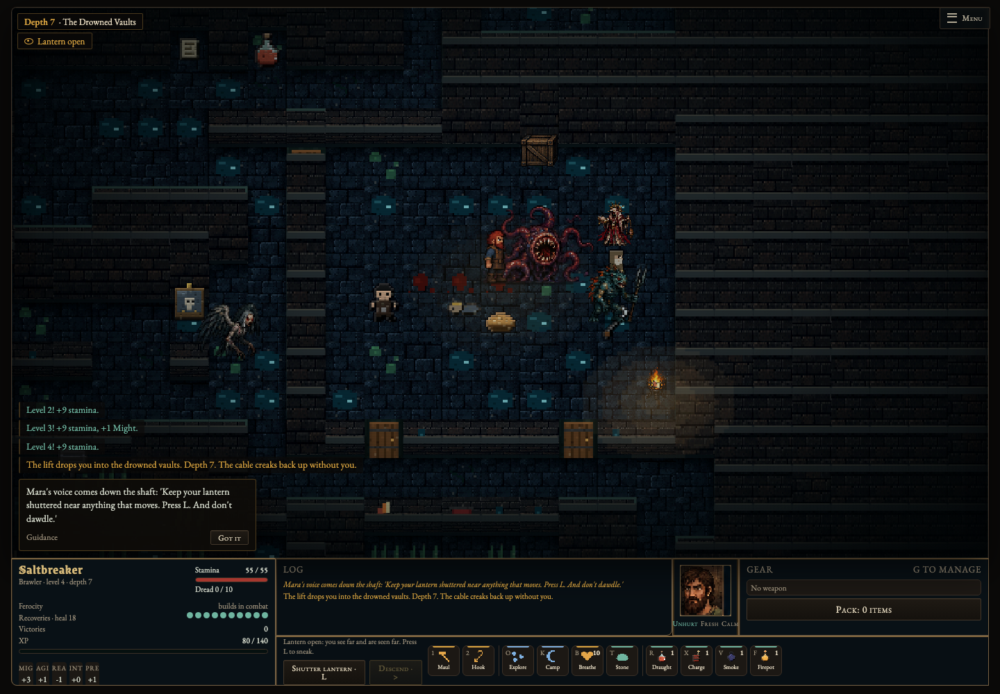
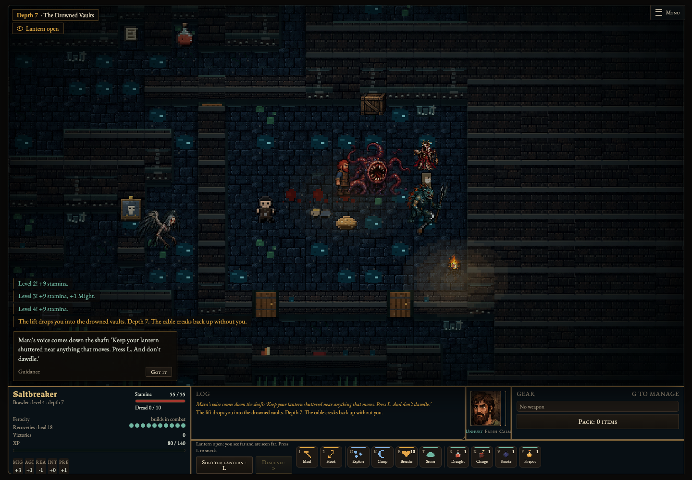

# Flat environment density pass

[Soft biome lighting and richer floor detail](biome-lighting.md) replaces blocky light pools and abrupt visibility brightness, with five lighting-only comparisons and normal-visibility views.

The latest update also [tightens town proportions and upgrades existing town saves](town-layout.md).

The current version includes the [smithy street and mining benchmark](environment-workyards.md), with a material kit, four original workyard sprites and refreshed screenshots. See that document for current validation and asset provenance.

This pass adds native canvas pixel art around the existing flat atlas assets. The square projection, actor/weapon renderer, turn resolution, collision map, object interactions, procedural gameplay RNG and navigation are unchanged. No mobile changes are included.

- Town: continuous street gutters, drainage grates, worn thresholds and short foundation shadows. Wall-side clusters echo the nearby smithy, chapel, archive and residential buildings: timber, tools, votives, books and planters.
- Mines: braced timber walls, broken salt seams, tool/ore piles and abandoned equipment silhouettes.
- Crypts: recessed burial niches, faded cloth, scattered offerings and candle stubs.
- Fungal hollows: layered shelf growth, cap beds and slow stepped bioluminescence.
- Drowned vaults: waterline courses, chains, encrusted broken timber and barnacles. Sewer/abbey palettes have compatible fallbacks.
- All biomes: quiet clustered floor wear and short wall-contact shadows; existing atlases, decals, lights and interactable props remain intact.

## Placement and layering contract

`environment-art.js` hashes the map into a stable visual seed; placement never calls `Math.random`. Plans and native 32px sprite canvases are cached separately from gameplay state. Ground silhouettes occupy the rear half of a floor tile, at most 16px tall. They require a rear wall, two side floor neighbors and an open floor below, so single-width corridors stay empty. The planner excludes authored decals and a one-tile radius around existing objects, loot, traps, NPCs, doors and special terrain. Draw-time guards suppress deposits when actors, items, objects, fragile floor or live hazards occupy the tile, and when terrain changes. Nothing adds a collision or interactable object; tactical hazards remain the combat task's responsibility.

The ground hook runs after existing dressing but before loot, death residue, overlays and actors. Wall details remain inside the existing depth-sorted wall entry and inherit visibility dimming/cutaway opacity. Cracked walls and authored wall clues are excluded. Rendering uses integer rectangles and cached native canvases with smoothing disabled. Reduced motion freezes fungal glow. No new particle system, timer or per-frame canvas allocation is introduced.

The plan is intentionally stable for each level object: changes to terrain suppress invalid existing decorations rather than randomly redressing a room mid-fight. New game/reloaded level objects derive the plan from the saved map.

## Validation

On macOS, 1440×1000 Chromium desktop viewport, DPR 1:

- `npm test`: **72 passing**, including 80 reproducible real dungeon generations (20 seeds at depths 1/3/5/7), immutability, no gameplay RNG consumption, corridor/entrance clearance, dynamic occupancy/hazard suppression, reduced-motion glow and renderer ordering.
- `npm run test:environment`: five real game scenes, matched screenshots with only the two environment hooks toggled, actual keyboard-equivalent traversal into decorated cells, unchanged navigation data, smoothing disabled and no runtime errors. About **6–14 ms per full render** in this local run (30 synchronous draws per scene; diagnostic, not a universal frame-rate promise).
- `npm run test:tactics`: desktop bomb inspect, round feedback, no wall-clock turn progression, immediate daze interruption; passes with the environment enabled.
- `npm run test:weapons`: all equipment/unequip, real attacks, turn invariants and impact timing at three paces pass on the combined environment + merged weapons code.
- `npm run test:art`: atlas loading, dimensions, native sprite sizes and unknown-actor fallback pass.
- `git diff --check`: passes.

The new Desktop environment art workflow runs the placement and browser checks and uploads PNG comparisons. Safari and physical GPU performance have not been measured. No merge or deployment is included.

## Matched screenshots

Captured from seeded real town/dungeon generation with the same map, camera and actors for each pair. Seen/visibility are revealed for review, and motion is reduced; these are art-comparison scenes, not claims about normal fog-of-war coverage. Before disables only the new environment hooks. Images are losslessly encoded.

| Scene | Before | After |
|---|---|---|
| Town |  |  |
| Mine |  |  |
| Crypt |  |  |
| Fungal |  |  |
| Drowned |  |  |

Integration: reconciled merged weapons main `1e148bd` with only cache-version and test-command conflicts; both sets of commands and the environment cache entry are retained. The gallery was regenerated on the combined code.
