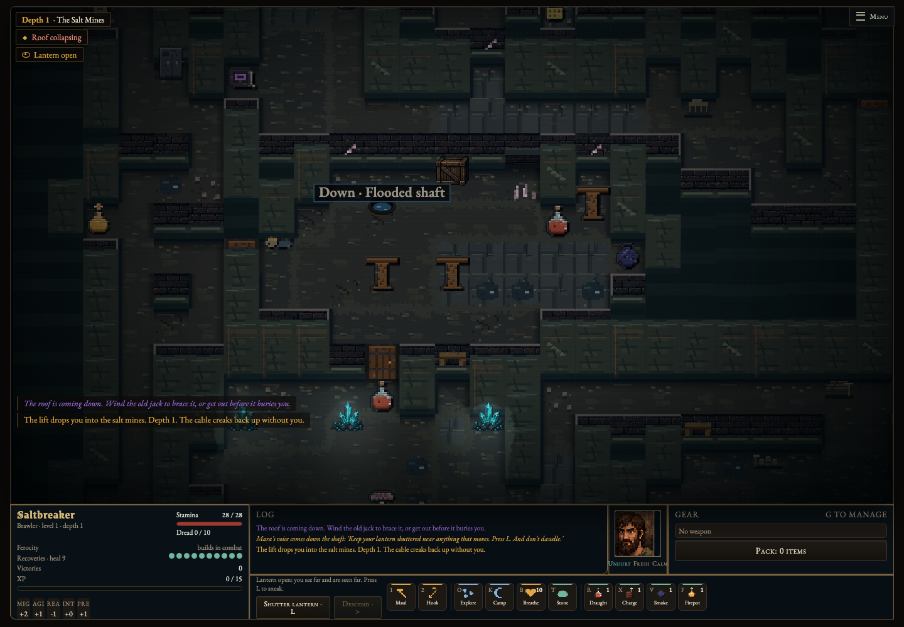
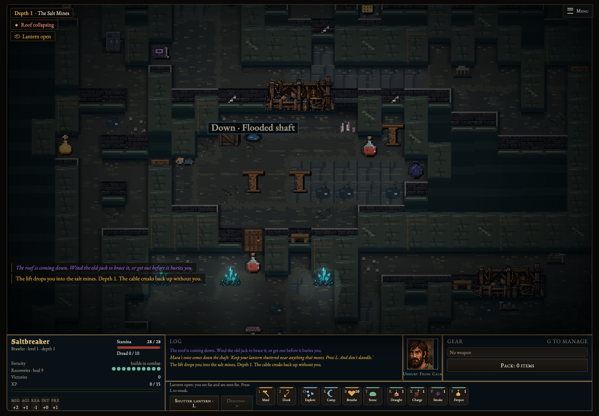
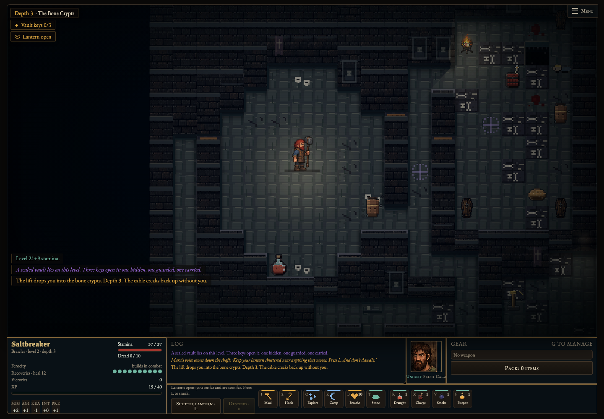
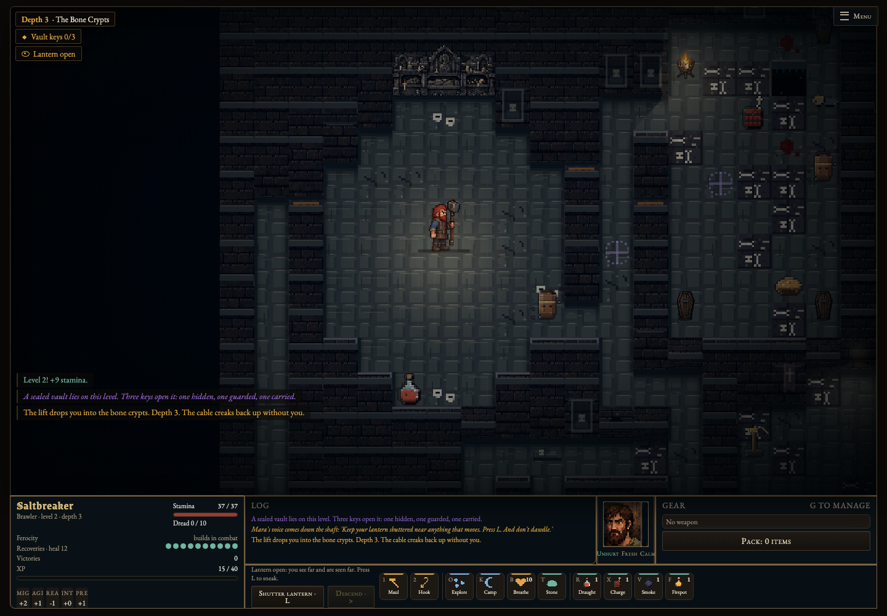
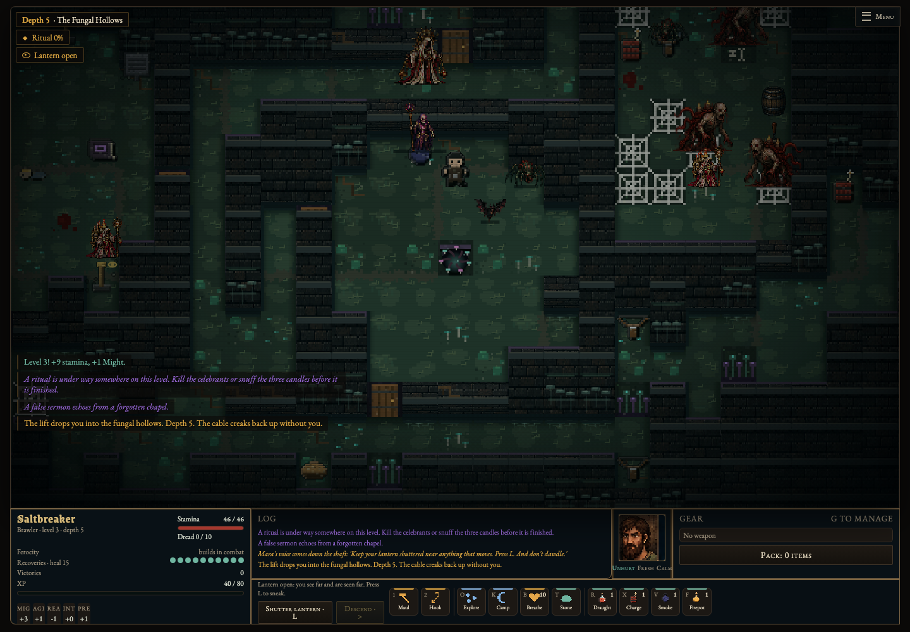
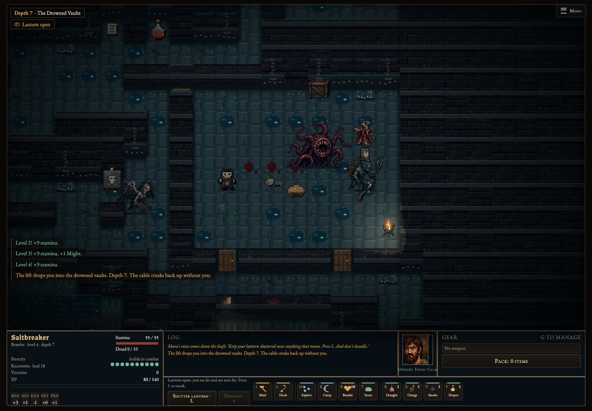
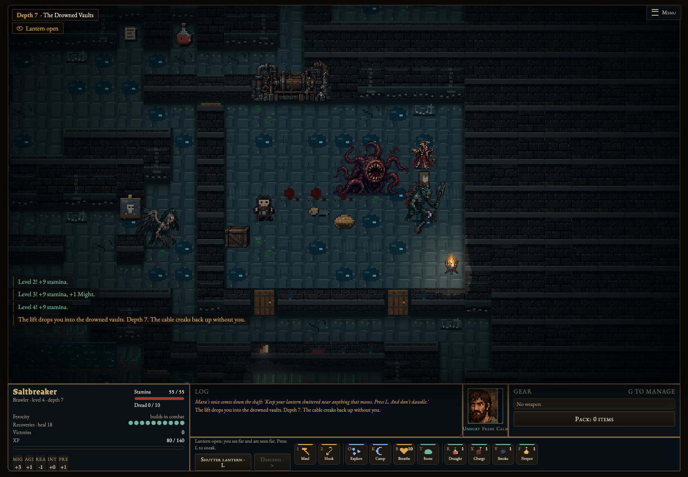

# Room composition

New dungeons use deterministic room composition: loading bays in mines, burial chambers in crypts/abbeys, fungal nests and derelict pump rooms in drowned/sewer levels. Four original wall-mounted focal pieces and restrained floor markings give each room a purpose. Existing props form edge banks around a reserved three-wide central spine and a horizontal crossing. These markings are visual; they do not create new movement rules.

Only ordinary existing crates, barrels, kegs, off-rail carts, coffins, statues, mushrooms and pods may move, at most six per suitable room. No loot, monsters, traps, exits, doors, terrain or authored decals are created or moved. Puzzle/key/note/story/fused props, ritual/vault rooms, small rooms and rail carts are excluded. Every candidate preserves all formerly reachable unoccupied floor and adjacent access to formerly accessible objects. Closed gates count as potentially open for this validation, matching the generator's access contract. Destinations avoid actors, loot, hazards, entrances, authored terrain and focal approaches. Existing fixed objects can remain in the central spine; the pass never moves critical props just to obtain visual symmetry.

Composition runs after population and encounter generation. Rebuild opacity, gameplay light and visibility after relocating existing opaque or luminous props; their existing effects follow their new positions. Combat rules, prop statistics, rewards, turn timing and equipment rendering are unchanged. Saves record versioned placement metadata and do not reshuffle on resume. Older dungeon saves receive visual wall/floor identity only. Towns and tutorials are excluded. Damaged, clue-bearing or incompletely revealed walls suppress focal art, as do nearby north-side actors that could otherwise be covered. Focal art ends at the wall foot, leaving floor telegraphs clear. Standard lighting and foreground cutaway apply; canvas smoothing remains disabled.

## Matched desktop comparisons

Both phases generate the same seed in fresh browser contexts; the before phase disables only room composition. Full map reveal is used for inspection. Camera and room match, terrain/population/prop identities match. Zero moves in a given room/seed are valid when no eligible placement exists.

| Biome | Before | After |
| --- | --- | --- |
| Mine |  |  |
| Crypt |  |  |
| Fungal |  |  |
| Drowned |  |  |

## Validation

- 84 Node tests pass, including 80 seeded composition runs (284 safe prop moves), deterministic output without RNG consumption, idempotence/serialization, unchanged terrain/population/non-position prop data, connectivity, objective access, exclusions, actor/fog/damage/clue suppression and offline packaging.
- Desktop Chromium room comparisons verify unchanged terrain, enemy/item/trap placement and prop identity across phases; repeated drawing preserves simulation state and disables smoothing. Representative renders measured roughly 8–15 ms on this machine, not a Safari/GPU guarantee.
- Desktop lighting, tactics, weapons and flat-reference browser suites pass. CI also captures fresh room comparisons.
- No mobile changes. No merge or deployment performed.

## Original art provenance

Asset: `assets/flat/room-focals.webp`. Created with the built-in ImageGen tool in reference-edit mode, using the repository's original `assets/flat/workyards.webp` only for style. Transparent source retained in the generation tool's output directory; lossless WebP conversion preserves alpha. Runtime crops equal quadrants by alpha bounds and downsamples with nearest-neighbor sampling to 96×48 native pixels. The atlas contains original designs, not copied game assets.

Exact prompt:

> Use case: stylized-concept. Production asset: one transparent 2x2 sprite atlas for flat 2D pixel-art Saltmarrow Deep. Input is a STYLE REFERENCE ONLY: match the richly textured crisp pixel clusters, weathered dark wood, blue-grey iron, muted stone, frontal slightly overhead upright view. Exactly four wide low wall-mounted architectural set pieces, one entirely in each equal quadrant, ample transparent gutters around each. Top left: abandoned mine loading-bay shelving framed with timber, stacked ore sacks and rough pallets, rope coils and a broken cargo hook, low wide silhouette. Top right: crypt burial recess with three recessed burial shelves, worn carved saint effigy, small skulls and candle stubs, ruined funerary relief, solemn cold stone, low wide silhouette. Bottom left: fungal nesting wall, tangled thick roots wrapped around cracked masonry, pale clustered egg cases, layered shelf mushrooms with restrained cool green bioluminescence, organic asymmetrical silhouette. Bottom right: seized medieval mine pump assembly against a wall, rusty broad piston cylinder, fixed cog wheels and curving broken iron pipes with tidal stains and encrustation, no modern technology, no bright usable handle. Each sprite about 2:1 width to height, all consistent scale. No floor platforms, no surrounding room or diorama, no characters, no text or labels, no UI, no fog, no bloom. Flat axis-aligned 2D view, NOT isometric or diamond view. Original art, do not copy assets from another game. Genuine transparent alpha background, empty transparent gutters. These will render at 96x48 native pixels as wall-bound room focal points.
