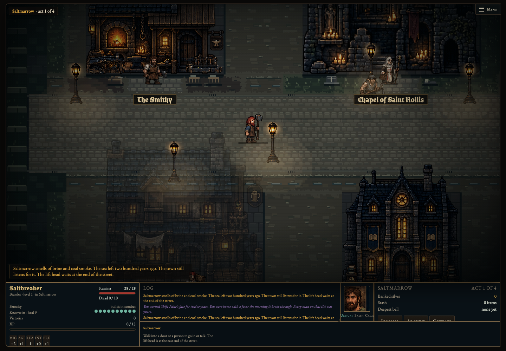

# Compact town layout

The town now has a two-tile carriageway with one-tile frontages, more closely grouped service buildings and a connected southern service lane. Smaller yards and two-tile side alleys give each building a defined place. The lift, arrival point, cottage, archive, chapel, smith, tavern, apothecary, town hall and four residential houses retain their roles.

| Measure | Previous layout | Compact layout |
|---|---|---|
| Main carriageway | 4 tiles | 2 tiles |
| Gap between north/south building footprints | 6 floor rows | 4 floor rows including frontages |
| Main settlement envelope, excluding lift annex | 49 × 22 tiles | 48 × 18 tiles (about 20% smaller) |
| Southern service access | Broad open rear yards | Connected two-tile service lane and marked door approaches |

Buildings retain their original sprite scale. Their positions, lamps, graveyard and houses move as a coherent layout. The gibbet and lottery box occupy the frontage rather than the road. Floor materials now follow the actual street, alleys, door approaches and yards. Grass appearance in unused yards does not introduce new opaque grass terrain. Late-story flooding stays in the roadside gutters, preserving the clear route to the lift.

Gas lamps fade when they would cover the player immediately behind them. Existing facade cutaways and the flat square-grid projection remain in place.

## Existing saves

Exterior towns carry layout version 2. Resuming an older exterior town regenerates only its town geometry and NPC placement. Player statistics, gold, equipment, bag, quests and meta progress are retained; dropped items are moved to a reachable floor if their old tile is now inside a building. The player returns near the corresponding service where possible, or to the nearest safe reachable floor without overlapping an NPC. Dungeon and interior saves are untouched. Interior exits use the current building entrance.

This is an intentional town-generation/navigation change. The environment art and dungeon dressing remain presentation-only; dungeon generation and combat are unchanged.

## Validation

- `npm test`: **75 passing**.
- New regression checks cover 120 seeded towns across all four acts: service approaches, four houses, NPCs, clear lift route, unique object IDs and valid placements. Every interior exits onto its matching exterior approach.
- Migration checks retain player/equipment/bag identity, gold, meta/quest data and dropped loot; repeated migration is a no-op, and interiors are not regenerated.
- Desktop environment browser: actual mouse entry into all seven services and return outside, actual legacy-save resume, traversable decorated floors, no runtime errors and disabled smoothing. Existing tactics, weapons and flat-reference browser suites pass.
- The environment workflow includes town layout tests and uploads fresh desktop screenshots.

## Before and after

These use the same desktop viewport and camera framing. Before is the archived prior workyard layout; after shows the compact town. Geometry and NPC placement intentionally differ. Both screenshots reveal visibility for review.

| Before | After |
|---|---|
|  |  |
