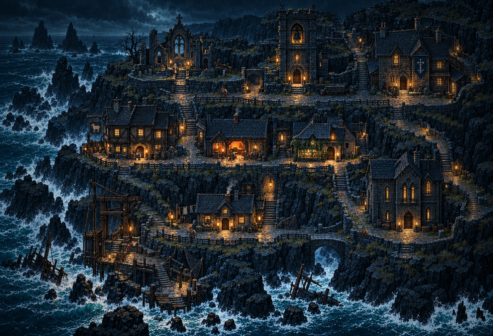
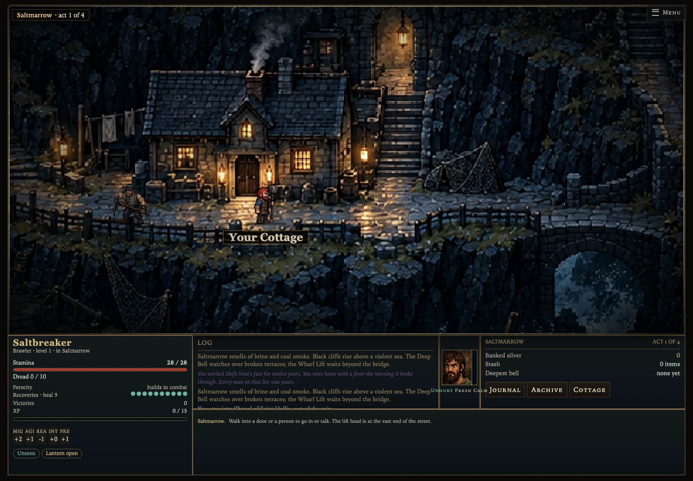
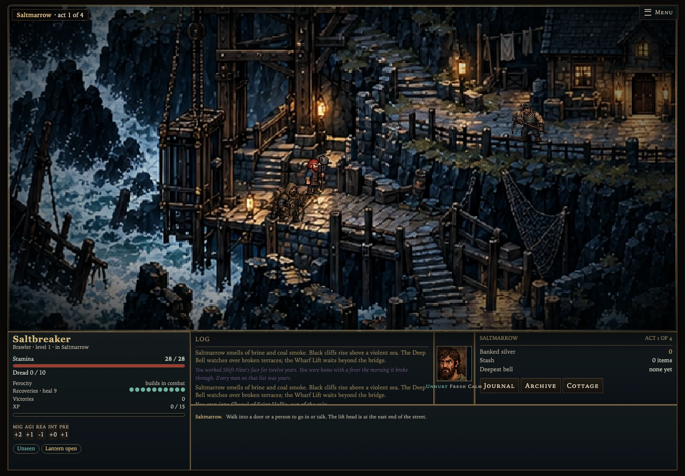
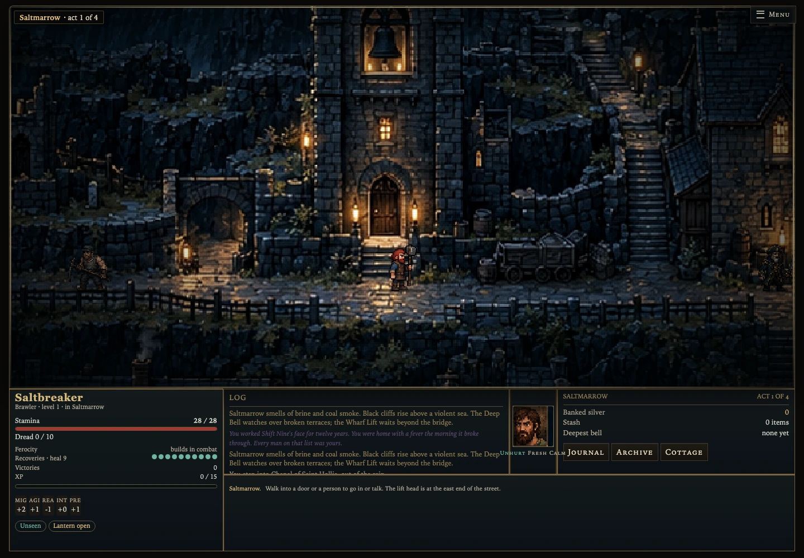
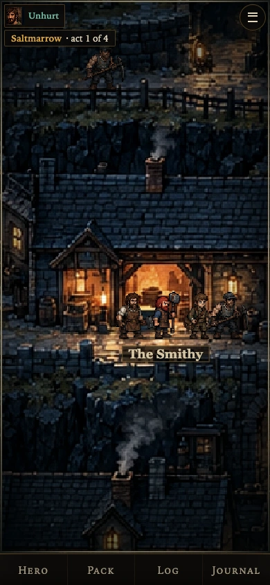
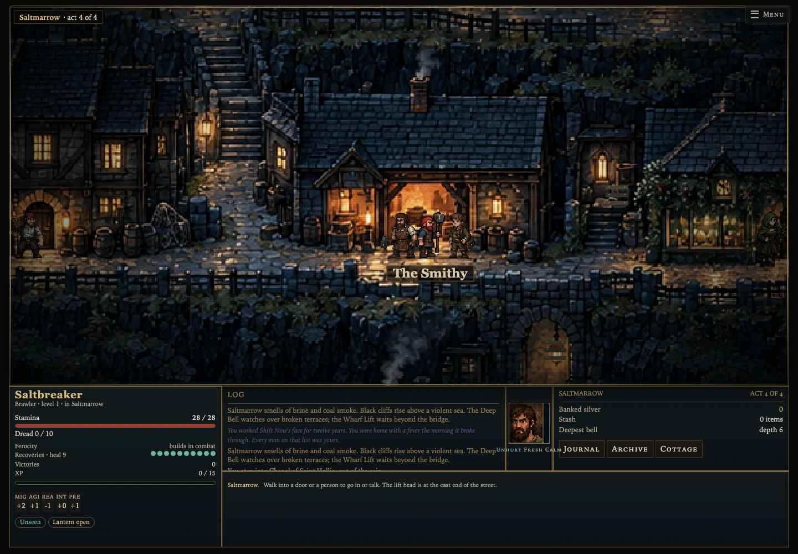

# Saltmarrow — rebuilt authored town

This replaces the rejected platform layout and its compositing experiments. The exterior is a completely new authored scene: architecture, retaining walls, stairs, cliff strata, sea and lighting share one composition, material scale and palette. The hub no longer assembles unrelated building sprites over a separate cliff texture.



## Art and renderer

`assets/town-v6/master.png` is the new generated master. `town.webp` is its packed 2016 × 1376 game image, registered to the existing 63 × 43 world at **32 pixels per tile**. Projection remains flat and axis-aligned; there are no isometric diamonds or hidden elevation costs. Live characters, dropped items, interaction/path highlights, rain, fog and the player's lantern are separate dynamic layers.

`town-coast.js` owns the authored image and sparse act overlays. `drawUnifiedTown` bypasses the old exterior tile, facade, cliff and set-dressing passes. Shared dungeon and interior rendering remain separate. The seven service interiors are retained. Door hit testing uses the registered facade and grid entry, while actor alpha picking retains direct NPC selection. Clicking an adjacent town NPC opens dialogue; keyboard movement can still step past people.

The townspeople and player use the existing actor system at a consistent human scale. Doors and routes were registered against the finished artwork, then tested through actual movement and mouse input.

## Complete registered layout

Coordinates are zero-based square-grid tiles. `approach` is the player's exterior standing tile; the clickable door is one tile north. Footprints describe interaction/collision registration, not separate pasted images.

| Landmark | Registered footprint x,y,w,h | Door | Approach | Character and story |
|---|---|---|---|---|
| Deep Bell Tower | 35,0,7,11 | Inspect at 38,11 | 38,12 | Sturdy warning tower integrated into the crown masonry. Its bell, rope and tide descriptions change in every act. |
| Chapel of Saint Hollis | 17,2,12,7 | 23,8 | 23,9 | Ruined faith above the western sea; exposed arches, candles and salt graves. Sister Agathe stands beside the stair. |
| Town Hall | 46,4,12,8 | 51,11 | 51,12 | Civic authority above the east road, with a weathered banner and repaired stonework. Hale retains the existing training and lottery story. |
| Drowned Lamb | 13,12,10,8 | 18,19 | 18,20 | Warm timber and stone refuge beside the coast; the lamb sign, nets and barrels belong to the same street painting. Bram's services remain. |
| Smithy | 26,15,8,5 | 30,19 | 30,20 | Open orange forge under slate, with coal, tools and anvil at the front. Tobias and Pip retain their roles. |
| Thorn Apothecary | 35,14,10,6 | 42,19 | 42,20 | Herb-lit frontage beside the east steps. It remains boarded until Nell is rescued. |
| Old Archive | 47,19,10,11 | 52,29 | 52,30 | Gothic records building at the lower eastern route; letters, narrow windows and ruined masonry face the sea. |
| Player Cottage | 25,24,9,6 | 29,29 | 29,30 | Modest repaired home with hearth, laundry, storage and a view over the lower arch bridge. Bed/stash/hearth interior retained. |
| Wharf Lift | painted site 11,22,13,17 | Gate 14,31 | 14,32 | Heavy wooden and iron winch above the breakers; nets, tide marks and wrecks explain the route into the depths. Mara stands on the deck. |

Four residential entrances are registered at **36,18; 34,23; 61,11; 22,28**. They board up through the existing act/bribery progression. Their short side approaches remain connected.

### Routes and scenic elevation

The complete primary route rectangles `(x,y,width,height)` are:

- Crown lane: **24,12,34,2**.
- Chapel stair: **23,9,2,12**.
- Working lane: **15,20,30,2**.
- Middle stair: **34,21,2,10**.
- Hall stair: **51,13,2,5**.
- Eastern landing: **44,17,14,2**.
- Eastern stair: **44,18,2,12**.
- Lower lane: **22,30,36,2**.
- Wharf deck: **13,32,10,2**, joined by **20,29,3,5**.
- Dock descent: **21,34,2,4**, landing at **19,36,4,2**.
- Bell approach: **38,11,1,2**.

Door approaches, the four residential niches and story scenes add short links. Building footprints and the front parapets override route rectangles. Nonwalkable curb strips are y13/x25–50, y21/x15–33 and x36–43, and y31/x23–50 and x55–57; the result is validated as a connected movement graph. The upper arch crossing occupies **31,12,3,1**, and the lower arch crossing **38,30,4,1**.

```text
                        DEEP BELL
      ST HOLLIS       [bronze bell]          TOWN HALL
          |                 |                   |
 CROWN ===stairs===== upper arch ===============stairs===
          |                                         |
     DROWNED LAMB —— SMITHY —— THORN          east landing
          working lane       |                    stairs
                         middle stair                |
 WHARF LIFT —— deck —— COTTAGE ==== lower arch ==== ARCHIVE
      ||                 laundry / nets         sea wall
      || into depths        |                         |
 ~~~~~wrecks~~~~~~~~~~~black cliff / surf / salt~~~~~~~~~~~
```

The image conveys height through hewn stairs, retaining walls, continuous foundations and the sea far below. The movement system still uses ordinary 32px tactical squares. The map's rock/ocean cells remain blocked, including against a pickaxe, so invisible floor cannot be excavated out of the image.

## Environmental storytelling

Six inspectable scenes remain nonblocking and reachable:

| Tile | Scene | Detail |
|---|---|---|
| 38,11 | Deep Bell Tower | Warning ropes → higher tide notch → unattended ringing → evacuation lines. |
| 21,30 | The Last Catch | A scratched-out wreck name and a catch ledger ending with a drawing of a hand. |
| 21,9 | Drowned Saint | Mineral growth covers the saint's face, while someone still tends the candles. |
| 54,31 | Unsent Letters | Rain-swollen letters name ships that never returned. |
| 30,30 | The Empty Chair | One cup, two coat hooks and a mining helmet full of rain. |
| 17,32 | Wharf Tide Gauge | The latest tide mark is above the keeper's shoulder. |

## Acts 1–4

The main composition stays coherent as the town declines. Existing quest flags, NPC identities, service unlocks and expedition progression are retained.

| Act | Mechanical and environmental progression |
|---|---|
| 1 | Four roaming residents; four homes still occupied. Meet the town and use its services. Thorn remains closed until Nell is rescued. The Deep Bell's polished rope tells of practiced survival. |
| 2 | One home boards up, one fewer resident remains, and the bell stair has a fresh tide mark. Rescue and trust flags continue normally. |
| 3 | Two homes boarded, two residents remain. The bell rings unattended; mycelium is described in the oldest mortar. The lottery and deeper expeditions continue. |
| 4 | Three homes boarded, one resident remains; bribery can close the fourth. Lower surfaces gain a subtle wet-water overlay. The bell text describes blankets and evacuation lines. Every service and the lift remain reachable. |

## Matched asset inventory

The town is authored as one environment, rather than a random assortment of isolated sprites. All reusable exports are derived from that same master, so they share its materials and lighting.

| Group | Files / contents |
|---|---|
| Master and runtime image | `master.png`, `town.webp` |
| Nine reusable composite sites | `sites/chapel.webp`, `hall.webp`, `tower.webp`, `tavern.webp`, `smith.webp`, `apothecary.webp`, `archive.webp`, `cottage.webp`, `wharf.webp` |
| Terrain/material swatches | `sites/paving.webp`, `stairs.webp`, `basalt.webp`, `surf.webp`, `seawall.webp`, `slate.webp` |
| Site registration | `sites.json`, including source rectangles and native 32px tile size |
| Integrated props | Nets, chains, winches, tide marks, whale-bone/saint details, barrels, carts, crates, laundry, candles, lanterns, salt staining and wreckage are painted into their sites. |
| Live layers | Existing actors and animation; carried/dropped loot, boarded doors, path targeting, weather and lantern pool. |

The site exports include their supporting rock/street context; they are **not transparent isolated building sprites or seamless terrain tiles**. The runtime uses the complete composition to preserve natural joins. The master is retained for future paintovers and new connected site modules.

## Save compatibility and checks

Exterior layout version **6** regenerates prior town geometry while retaining the player, gold, equipment, bag, quests, trust and meta progress. Dropped items move to reachable floor if necessary. The nearest-safe-floor search spans the new layout. Existing interiors and dungeon saves are preserved; every service exit returns to its new exterior approach without overlapping an NPC.

The test suite covers 120 seeded towns across all four acts, service/house/NPC/story reachability, both bridges, all interior returns, old-save migration and coastline immutability. The browser suite uses actual exploration actions, mouse entry/exit for all seven services, direct NPC dialogue, lift preparation, blocked sea edges and read-only rendering. Desktop, mobile and wide-screen views are captured. The cross-environment browser suite additionally checks dungeon rendering and actual legacy resume.

The web cache and both native bundles include the new runtime image. The retired coastal kit is archived outside the active repository under `Game/art-archive`; it is not composited into the rebuilt hub. Unrelated dungeon, actor and interior assets remain available to their systems.

## Actual in-game views






## Art provenance and production prompt

The [verbatim imagegen prompt](art-prompt.txt) is saved with this design.

Generated with the built-in imagegen tool, using the new spatial blockout and the existing `assets/flat/home.webp` title artwork as references. The source blockout was a layout guide, not art to retain. The final art was then registered, packed with nearest-neighbor sampling and integrated into the playable game.

> Create a completely new unified game environment painting for Saltmarrow Deep. Preserve the approximate nine landmark locations, sizes, front doors and connected narrow routes from the spatial blockout, without copying its boxes, text or flat platforms. Use the title art's gothic black coastal cliffs, ancient weathered basalt masonry, storm seas, amber windows and survival-at-the-edge-of-the-world atmosphere. One cohesive scene, not a sprite sheet or collection of cutouts. Fixed slightly overhead orthographic camera, upright front facades and visible roof/ground surfaces, axis-aligned routes, no isometric diamond projection. Consistent small crisp pixel clusters, stone and slate scale, with no smooth photographic texture patches. A compact layered promontory settlement carved into one continuous rock formation. Buildings grow from the same stone as the retaining walls, with embedded foundations, hewn stairs, repaired cobbled lanes, small bridges, arches and balconies. No broad empty paved rectangles. Include the Deep Bell, Saint Hollis chapel, Town Hall, Drowned Lamb, Smithy, Thorn, Old Archive, Cottage and Wharf Lift, each with a clear connected door. Integrate four attached homes and coastal/mining details around path edges. Storm sea and surf on the left and bottom, wrecks and distant stacks. Muted cold blue-charcoal stone with restrained warm amber lights, readable nighttime midtones and consistent upper-left sky light. No people, labels, UI, visible grid or borders. Prioritize coherent composition, natural joins, grounded foundations, asymmetry and handcrafted environment-art quality.







Verified local results: **106 automated tests**, 120 seeded four-act town layouts, **277 real movement steps per act**, seven mouse service entries/exits per act, direct NPC dialogue, Wharf Lift preparation, blocked ocean/pickaxe edges, old-save resume, and desktop/mobile/wide-screen render captures. All checks passed. The new scene remains unmerged for visual review.
