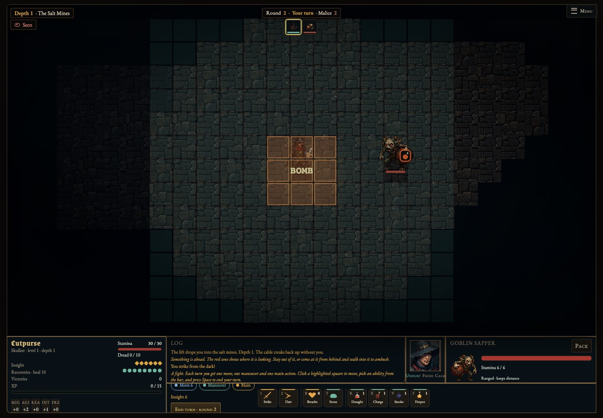
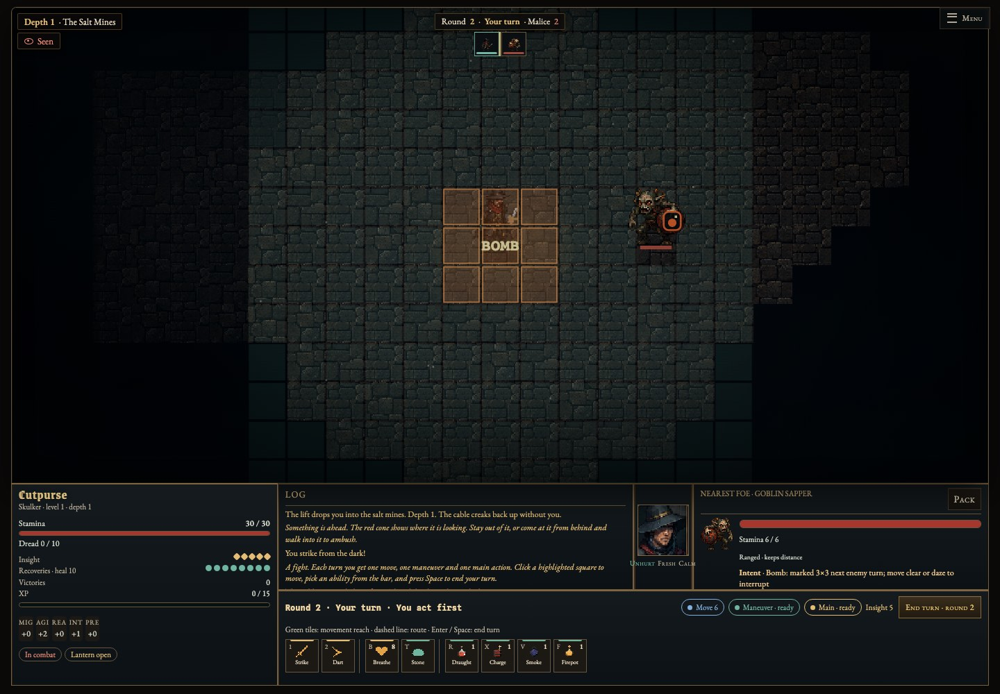
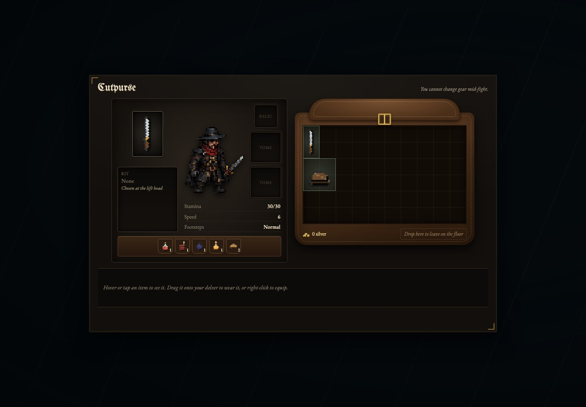
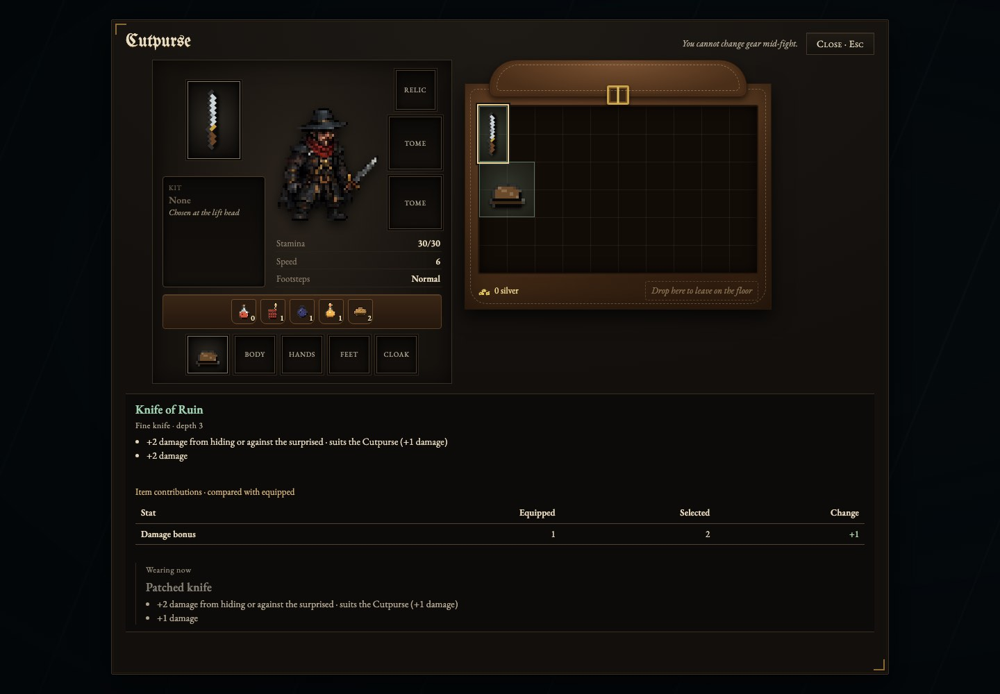
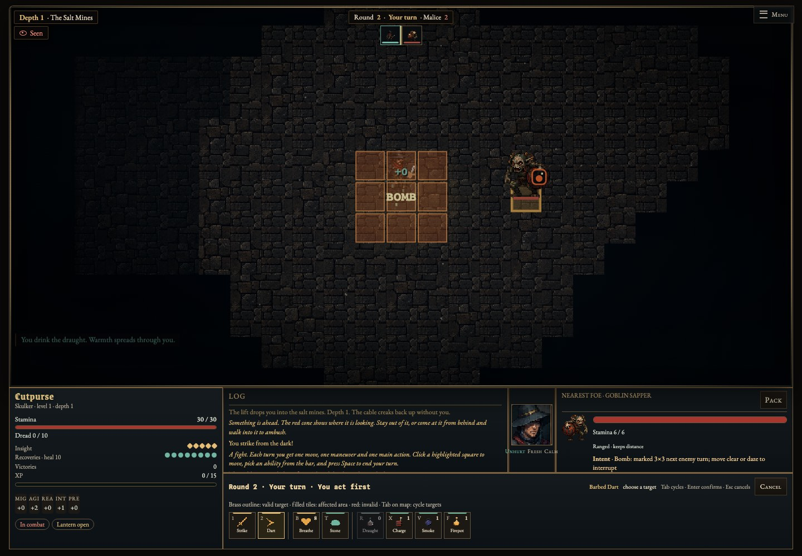

# Desktop UI review

This pass preserves the flat pixel renderer and turn-based rules. HUD data comes from `S.C`, `moveAvail`, `abUsable`, and `intentText`; comparisons use item base stats and identified affixes. It does not add new combat statistics or change enemy AI, weapon rules, or environment art.

- Dark iron panels, brass rules, parchment text and crisp existing pixel icons.
- Explicit round/phase/initiative, ready/spent actions, target identity and live enemy intent.
- Existing movement, attack and area previews gain a visible legend. Tab cycles targets while the map has focus; Shift+Tab cycles backwards. Esc cancels.
- Action descriptions appear on mouse hover and keyboard focus, including unavailable actions and their reason. Enter/Space on focused UI controls cannot also end the turn.
- Pack exposes all five armour slots, keyboard item selection, visible close, real equipment actions and numeric item-contribution comparisons. Unidentified comparisons remain hidden; combat equipment restrictions remain enforced. Base properties, curses and conditional effects remain in the full descriptions beside the comparison.
- Dialog focus stays contained and returns to its opener or the map. Passive map HUD elements do not intercept canvas input.

The top tracker represents phase order; enemies act nearest first according to the existing enemy phase implementation. Positions can change and some enemies take additional turns, so the UI does not promise a fixed initiative timeline.

## Visual evidence

Same desktop fixture at 1440×1000, with local test state to make a primed enemy and comparable equipment reachable. No fixture hook is shipped in the game. Procedural generation and ambient animation can vary between captures.

| Screen | Before | After |
| --- | --- | --- |
| Combat HUD |  |  |
| Inventory |  |  |

## Validation

- `npm test`: 59 passing tests.
- `npm run test:ui`: desktop layout at 1440×1000 and 1280×800; real enemy intent, unchanged turn across wall-clock wait, focus-safe action activation, unavailable-action tooltip, canvas hit testing, target cycling, identified comparison, combat gear lock, keyboard equipment updates, dialog trapping and focus restoration.
- Existing tactical, gameplay, weapons and home-screen browser regressions.
- Screenshots inspected for HUD clipping and inventory wrapping; both corrected.

Run `SCREENSHOT_DIR=test-results npm run test:ui` to reproduce current screenshots. CI runs this check and uploads screenshots alongside renderer regressions. Validation here uses Chromium on macOS; a native Safari run is still useful before release.
