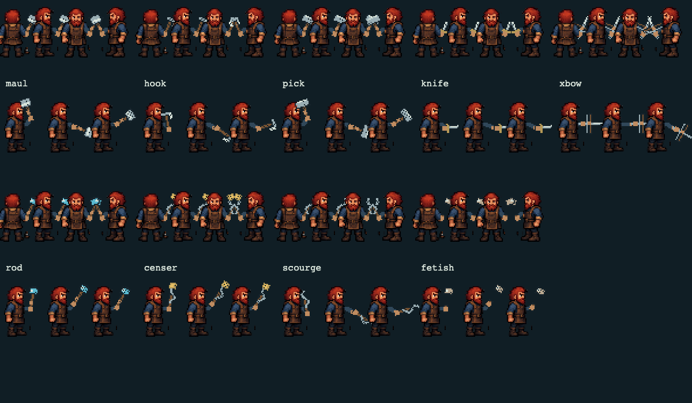
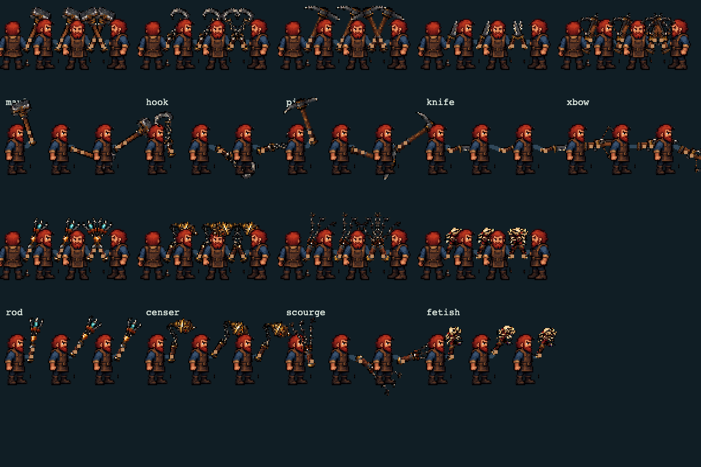

# Weapon art and ability choreography

Base: main `9bf5a8a` (2026-10-27). Flat 2D pixel art, turn-based rules and Mac desktop browser input retained. No merge or deployment is implied.

## Revised artwork after visual feedback

The first procedural art pass was rejected by the user. The replacement is an authored transparent sprite atlas, `assets/flat/weapons-v2.png`, generated against the actual miner artwork. It provides textured steel bevels, leather, grain, brass fittings and bone carving. The atlas is the shipped source, not a concept sheet. Equipped sprites use per-weapon native dimensions, hard alpha, inverse nearest-pixel sampling and anchored mirrored grips; inventory uses separately extracted 96px source sprites, with upright sizing for tall pack slots. Ability profiles and the full-body integration contract are retained. See [source prompt](weapon-art-v2-prompt.md).

## Implemented weapons and render paths

| Weapon | Actual family | New pixels |
|---|---|---|
| maul | mace / impact | Riveted square head, steel bands, worn haft |
| hook | hook / piercing | Open gaff curve, articulated chain links |
| pick | axe / breaking | Asymmetric curved mining spike and collar |
| knife | dagger / piercing | Bevelled blade, wrapped grip, brass guard |
| xbow | ranged | Limbs, string, bolt rail, trigger and reload without bolt |
| rod | staff / casting | Copper coils, pronged conductor, cyan core |
| censer | censer / holy | Chain, brass cage, vents, ember core |
| scourge | whip / drain | Three separate barbed wire strands |
| fetish | focus / void | Bone skull, sockets, teeth, horns and binding |

`WBASE` contains exactly these nine bases. Rarity, names, affixes and curses generate instances, not additional bases. `flat-art.js` also supports the unshipped aliases sword, axe, spear, dagger, bow, staff, shield and mace; their fallback rendering is preserved. Armour, kits, relics and tomes are separate equipment categories.

Render hookups:

- `weapon-art.js`: shared authored sprite pixels for equipped and item variants; authored three-pose tracks with smooth interpolation into anticipation, contact, follow-through and rest. Integer pixels and mirrored hand anchors; north behind body, other directions in front, sleeve and support hand connect grips.
- `flat-art.js`: original `weaponKind`, `weaponStyle`, `weaponDeathKind`, `weaponPose`, `drawWeapon` remain the compatibility entry points. The new module decorates the pose/drawing functions without changing their signatures.
- `index.html` final `drawSprite`: selects equipped weapon for idle, walk and actions, then composes behind/in front of `ART.heroBody`. Existing `animation-art.js` body and hit/death frame selection remain authoritative.
- `SPR.weapon_<base>`, `SPRW`, `ICON`, `gearSpr`, `itemImg`: shared source supplies pack grid, paper doll, gear sidebar, shops, comparisons/tooltips and dropped world gear, including both legacy and flat world renderer paths. Existing DOM equipment hooks remain intact.
- `flashAttack` → `WEAPON_ACTIONS` → `weaponContact` → `weaponRecovery`: profile timing and hand track use the same resolution clock; each profile exposes `bodyFamily` (`heavy`, `thrust`, `sweep`, `cast`, `utility`) for the separate body renderer, and actions retain `id`, `style` and `profile`; actual damage/effect application owns contact. Area damage resolves contact once. Delays hold the contact pose/effect and extend recovery. Existing `S.busy` remains held until the action returns. No turn, resource, target, balance or hit-rule changes.
- `doUtility`: utility anticipation precedes its authoritative implementation; self effects and movement resolve through existing code, then recovery completes. Reduced motion and quiet simulation bypass added waits.
- `freeStrike`: retains existing short opportunity-strike timing and death context. It is an implicit reaction, not an extra player action.
- `sw.js`, Mac and existing offline bundle copy lists include the new runtime.

## Every static player ability

All rows have distinct authored hand tracks, not a weapon-family override. VFX names refer to the existing bespoke effect renderers, retained where available. Timing is normal-speed anticipation + existing 170 ms roll/contact interval + recovery; optional fast/instant settings scale it. Each track also returns through a follow-through pose.

| ID | In-game name | Kind | VFX | Windup / recovery ms | Anticipation → contact → follow-through (x,y,radians) |
|---|---|---|---|---|---|
| undertow | Maul Swing | melee | smash | 380 / 430 | (-5, -12, -2.8) → (12, 5, 0.6) → (7, 8, 1.1) |
| gaff | Chain Hook | melee | hook | 330 / 490 | (3, -3, -0.6) → (17, -2, 0) → (-5, 3, -1.7) |
| breakwater | Whirlwind | burst | spin | 400 / 500 | (-8, 0, -3) → (15, 0, 3.1) → (-4, 4, 5.5) |
| redtide | Bonebreaker | melee | uppercut | 460 / 540 | (-4, 12, 1.9) → (10, -14, -1.5) → (4, -10, -2) |
| gutter | Gutter Strike | melee | slash | 270 / 330 | (-4, -2, -2.2) → (10, 1, 0.3) → (7, 4, 0.8) |
| fishhook | Barbed Dart | ranged | dart | 310 / 410 | (-7, -5, -2.5) → (15, -3, -0.1) → (4, 2, 0.5) |
| knife | Knife in the Dark | melee | thrust | 440 / 480 | (-7, 2, -0.4) → (17, -1, 0) → (11, 1, 0.1) |
| inkcloud | Smoke Bomb | self | scatter | 300 / 390 | (0, 7, 0.4) → (10, 4, 1.4) → (2, 6, 0.7) |
| eelstep | Tumble | step | hamstring | 240 / 350 | (-6, 8, -2) → (5, 10, 0.7) → (1, 4, -0.7) |
| brinebolt | Torrent Bolt | ranged | cast | 390 / 440 | (-4, -8, -2) → (12, -6, -0.4) → (7, -3, -0.8) |
| squall | Squall | ranged | gust | 360 / 470 | (-8, 0, -1.7) → (15, -5, -0.2) → (8, -2, -0.5) |
| grasp | Undertow | ranged | tendril | 440 / 510 | (10, -4, -0.4) → (-6, 0, -1.7) → (-9, 4, -2) |
| staticlash | Static Lash | area | zap | 470 / 540 | (0, -17, -1.7) → (5, -13, -1.2) → (1, -5, -1.5) |
| waterspout | Geyser | area | geyser | 530 / 600 | (0, 6, 0.4) → (0, -20, -1.6) → (3, -12, -1.3) |
| scourge | Scourge | melee | whip | 360 / 460 | (-8, -7, -3) → (16, 0, 0.2) → (7, 8, 1.5) |
| smite | Censer Smite | ranged | throw | 420 / 500 | (-6, -10, -2.7) → (15, -6, -0.2) → (9, 2, 0.6) |
| penance | Penance | none | slash | 420 / 520 | (9, -12, -0.4) → (-9, -3, -3.5) → (-3, 6, -2.5) |
| litany | Litany of Ash | burst | nova | 480 / 550 | (-5, -4, -2) → (9, -11, -0.7) → (5, -4, -1) |
| martyr | Martyr's Light | none | pillar | 590 / 690 | (0, 6, -1) → (0, -22, -1.6) → (0, -14, -1.5) |
| mindspike | Mind Spike | ranged | spike | 380 / 460 | (-2, -8, -1.9) → (13, -8, -0.1) → (7, -5, -0.5) |
| gaze | Abyssal Gaze | ranged | gaze | 460 / 530 | (0, -10, -1.5) → (4, -12, -1.4) → (3, -8, -1.3) |
| veil | Veil of the Other | none | unravel | 420 / 470 | (9, 2, 0.3) → (-6, -10, -2.4) → (-4, -5, -2) |
| unravel | Unravel | area | unravel | 510 / 590 | (8, -6, -0.5) → (-9, -12, -2.8) → (-7, -6, -2.3) |
| rend | Rend the Veil | area | rend | 580 / 650 | (-4, -18, -2.8) → (11, 8, 1.4) → (9, 10, 1.7) |
| ironwake | Ironwake | melee | smash | 490 / 580 | (-9, -9, -3.1) → (16, 7, 0.8) → (12, 10, 1.3) |
| lastlight | Last Light | burst | rebuke | 540 / 610 | (-3, -15, -1.8) → (8, -19, -1.1) → (5, -9, -1.3) |
| stormglass | Stormglass | area | fork | 520 / 590 | (4, -18, -1.3) → (-3, -10, -2) → (6, -5, -0.8) |
| brandofsalt | Salt Brand | ranged | brand | 350 / 430 | (-5, 4, -1.8) → (14, -2, 0) → (6, 2, 0.4) |
| memoryleech | Memory Leech | ranged | leech | 490 / 570 | (12, -9, -0.3) → (-7, -7, -2.2) → (-4, 3, -1.8) |
| shift | Shift | step | thrust | 200 / 280 | (-2, 0, -1.2) → (3, 1, -1) → (0, 0, -1.15) |
| shove | Shove | melee | thrust | 330 / 410 | (-7, 1, -1.5) → (12, 2, -0.1) → (6, 3, -0.5) |
| hide | Hide | none | gaze | 340 / 420 | (5, 0, -0.7) → (-6, 5, -2.6) → (-3, 4, -2) |
| defend | Defend | none | rebuke | 400 / 500 | (-4, 2, -1.9) → (0, -9, -1.5) → (0, -7, -1.4) |
| dash | Dash | none | gust | 220 / 300 | (-6, 3, -2) → (6, 5, 0.2) → (1, 3, -1) |
| breath | Catch Breath | none | nova | 480 / 580 | (-2, 4, -1.1) → (1, -4, -1.4) → (0, 1, -1.2) |
| escape | Break Free | none | garrote | 410 / 490 | (-8, 3, -2.5) → (10, -4, 0.2) → (4, 2, -0.6) |
| stone | Toss Stone | point | heave | 320 / 400 | (-6, -6, -2.4) → (13, -4, -0.2) → (7, 3, 0.4) |
| draught | Healing Draught | none | leech | 400 / 480 | (0, 6, -0.5) → (-3, -9, -2) → (0, 4, -1) |
| charge | Blasting Charge | none | scatter | 470 / 550 | (-2, 8, 0.5) → (6, 14, 1.2) → (2, 8, 0.7) |
| ink | Smoke Bomb | none | scatter | 350 / 440 | (-5, 7, 0.7) → (12, 5, 1) → (4, 6, 0.6) |
| tea | Dreamless Tea | none | whisper | 440 / 520 | (2, 5, -0.3) → (-4, -8, -2.1) → (-1, 5, -1) |
| oil | Firepot | point | throw | 380 / 470 | (-8, -8, -2.7) → (15, -5, -0.1) → (8, 4, 0.5) |
| clapper | Drowned Clapper | none | rebuke | 520 / 600 | (-5, -12, -2.5) → (10, -15, -0.6) → (4, -7, -1.2) |
| shadowstep | Shadowstep | point | rift | 380 / 460 | (9, 3, 0.2) → (-9, -8, -2.9) → (-4, 2, -2) |
| camp | Make camp | none | nova | 500 / 600 | (-2, 10, 0.8) → (4, 13, 1.3) → (0, 7, 0.4) |
| autoexp | Explore | none | gust | 200 / 260 | (-3, 2, -1.4) → (4, 3, -0.8) → (0, 1, -1.1) |
| quake | Ground Slam | burst | slam | 530 / 620 | (0, -21, -2.9) → (9, 13, 1.6) → (6, 14, 1.8) |
| headbutt | Headbutt | melee | butt | 300 / 420 | (-8, 2, -1.8) → (-4, 6, -1.4) → (-6, 3, -1.6) |
| chainlash | Hurl Rubble | ranged | heave | 480 / 560 | (-9, 9, 1.5) → (14, -10, -0.7) → (10, 0, 0.2) |
| bloodrage | Blood Rage | none | brand | 390 / 500 | (-3, 5, -1.4) → (-4, -6, -1.7) → (-2, 2, -1.3) |
| caveblow | Cave-In | area | cavein | 610 / 700 | (-5, -21, -3) → (12, 12, 1.4) → (10, 14, 1.6) |
| flurry | Flurry of Knives | burst | fan | 410 / 520 | (-9, -4, -3) → (14, 0, 5.8) → (4, 6, 7) |
| garrote | Garrote | melee | garrote | 450 / 580 | (11, -9, -0.1) → (-7, -5, -2.6) → (-9, 1, -2.8) |
| caltrops | Caltrops | area | scatter | 330 / 440 | (-4, 8, 0.9) → (15, 8, 0.2) → (6, 9, 0.6) |
| venomdart | Venom Dart | ranged | dart | 390 / 490 | (-6, -10, -2.8) → (16, -5, -0.1) → (7, 1, 0.4) |
| vanish | Hamstring | melee | hamstring | 370 / 450 | (-7, 11, 2.4) → (14, 12, 0.5) → (8, 13, 1) |
| hail | Hailstorm | area | hail | 560 / 630 | (-2, -19, -1.8) → (8, -17, -0.8) → (4, -10, -1.1) |
| forked | Forked Lightning | ranged | fork | 450 / 510 | (-9, -8, -2.3) → (15, -9, -0.2) → (8, -6, -0.6) |
| maelstrom | Maelstrom | burst | vortex | 510 / 590 | (-12, 0, -3) → (12, -10, 3.5) → (2, -8, 5) |
| seafog | Sea Fog | none | gust | 440 / 500 | (7, 4, 0.4) → (-9, 2, -3) → (-2, 5, -1.7) |
| ballstorm | Whirlpool | area | whirl | 570 / 650 | (11, -5, 0) → (-10, -13, -3.2) → (-5, -6, -2.4) |
| brand | Holy Brand | melee | brand | 430 / 530 | (-6, -2, -1.9) → (16, -3, 0) → (14, -2, 0.1) |
| pillar | Pillar of Fire | area | pillar | 600 / 690 | (-4, -20, -1.9) → (3, -23, -1.3) → (2, -13, -1.5) |
| offering | Blood Offering | none | leech | 430 / 510 | (2, 7, 0.3) → (-5, 1, -2.2) → (-3, 5, -1.8) |
| rebuke | Rebuke | burst | rebuke | 470 / 570 | (-8, -3, -2) → (17, -4, -0.1) → (9, -1, -0.4) |
| judgement | Judgement | melee | judge | 650 / 740 | (-7, -23, -3.1) → (14, 10, 1.3) → (12, 15, 1.7) |
| leech | Life Leech | ranged | leech | 440 / 530 | (14, -3, -0.2) → (-8, 3, -2.4) → (-5, 5, -2) |
| whispers | Maddening Whispers | area | whisper | 550 / 620 | (-4, -13, -2) → (6, -16, -0.9) → (0, -9, -1.4) |
| hex | Hex | ranged | hex | 410 / 490 | (-8, -7, -2.4) → (11, -10, -0.6) → (4, -6, -1) |
| mirror | Black Mirror | ranged | gaze | 500 / 580 | (5, 4, -0.5) → (3, -16, -1.5) → (4, -12, -1.4) |
| rift | Void Rift | area | rift | 620 / 710 | (12, -12, -0.2) → (-12, -15, -3.2) → (-8, -7, -2.8) |

## Generated tomes

Every tome is a combination of six elements (fire, frost, lightning, holy, void, blood) and five shapes (bolt, area, burst, ward, blink): 30 visual variants. Element selects pillar/hail/fork/nova/rift/leech VFX and accent colour; shape selects forward projection, overhead placement, circular release, defensive raise or fold-and-release tracks. Element modifies contact height and timing. Tome instance IDs, random names, damage tiers and riders do not create additional animation families.

## Verification and concurrent work

65 unit/regression checks pass. Chromium browser audit executes all 47 offensive static abilities and 11 representative utilities, checks authored profile selection, recovery completion, impact timestamps, delayed damage, all nine equipment bases, unequip, accessibility, speed settings and unchanged turn counters. Tactical browser regression passes. The same full audit passes in WebKit on macOS.

Evidence: `weapon-poses.png` (nine weapons, four directions, phases), `ability-tracks.png` (all authored tracks), `weapons-desktop.png` (real desktop gameplay), `ability-audit.json` (runtime enumeration).

Coordinated with weapon visibility, tactical combat, UI and environment chats. UI PR #29 does not edit sprite/profile APIs. Combat-feel work is concurrently replacing body frames and adding its own action clock. `weaponRecovery` explicitly delegates when `FEEL.actions` owns the actor; `feelFinish` must await the maximum body/weapon deadline. Review the combined branch before merging both. A baked-in maul body animation must not draw a second procedural maul, and other weapons must retain their swappable sprites. This branch deliberately does not overwrite those pending body/environment/UI changes.
